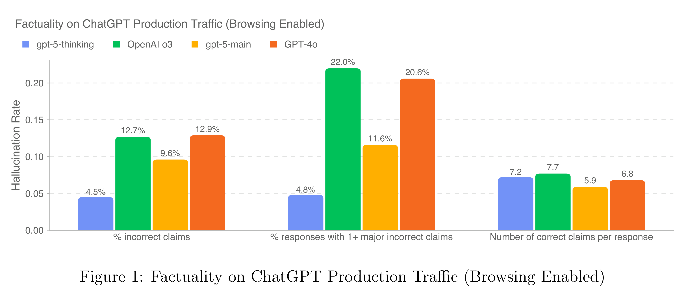
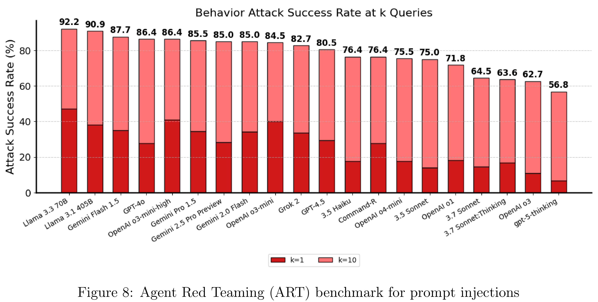

# GPT-5 System Card

[Official source](https://deploymentsafety.openai.com/gpt-5)

## Introduction

GPT-5 is a unified system with a smart and fast model that answers most questions, a deeper reasoning model for harder problems, and a real-time router that quickly decides which model to use based on conversation type, complexity, tool needs, and explicit intent (for example, if you say “think hard about this” in the prompt). The router is continuously trained on real signals, including when users switch models, preference rates for responses, and measured correctness, improving over time. Once usage limits are reached, a mini version of each model handles remaining queries. In the near future, we plan to integrate these capabilities into a single model.

In this system card, we label the fast, high-throughput models as gpt-5-main and gpt-5-main-mini, and the thinking models as gpt-5-thinking and gpt-5-thinking-mini. In the API, we provide direct access to the thinking model, its mini version, and an even smaller and faster nano version of the thinking model, made for developers (gpt-5-thinking-nano). In ChatGPT, we also provide access to gpt-5-thinking using a setting that makes use of parallel test time compute; we refer to this as gpt-5-thinking-pro.

It can be helpful to think of the GPT-5 models as successors to previous models:

Previous model

GPT-5 model

GPT-4o

gpt-5-main

GPT-4o-mini

gpt-5-main-mini

OpenAI o3

gpt-5-thinking

OpenAI o4-mini

gpt-5-thinking-mini

GPT-4.1-nano

gpt-5-thinking-nano

OpenAI o3 Pro

gpt-5-thinking-pro

This system card focuses primarily on gpt-5-thinking and gpt-5-main, while evaluations for other models are available in the appendix. The GPT-5 system not only outperforms previous models on benchmarks and answers questions more quickly, but—more importantly—is more useful for real-world queries. We’ve made significant advances in reducing hallucinations, improving instruction following, and minimizing sycophancy, and have leveled up GPT-5’s performance in three of ChatGPT’s most common uses: writing, coding, and health. All of the GPT-5 models additionally feature safe-completions, our latest approach to safety training to prevent disallowed content.

Similarly to ChatGPT agent, we have decided to treat gpt-5-thinking as High capability in the Biological and Chemical domain under our Preparedness Framework, activating the associated safeguards. While we do not have definitive evidence that this model could meaningfully help a novice to create severe biological harm–our defined threshold for High capability–we have chosen to take a precautionary approach.

Figure 1: Factuality on ChatGPT Production Traffic (Browsing Enabled)

p. 13

Figure 8: Agent Red Teaming (ART) benchmark for prompt injections

p. 22
