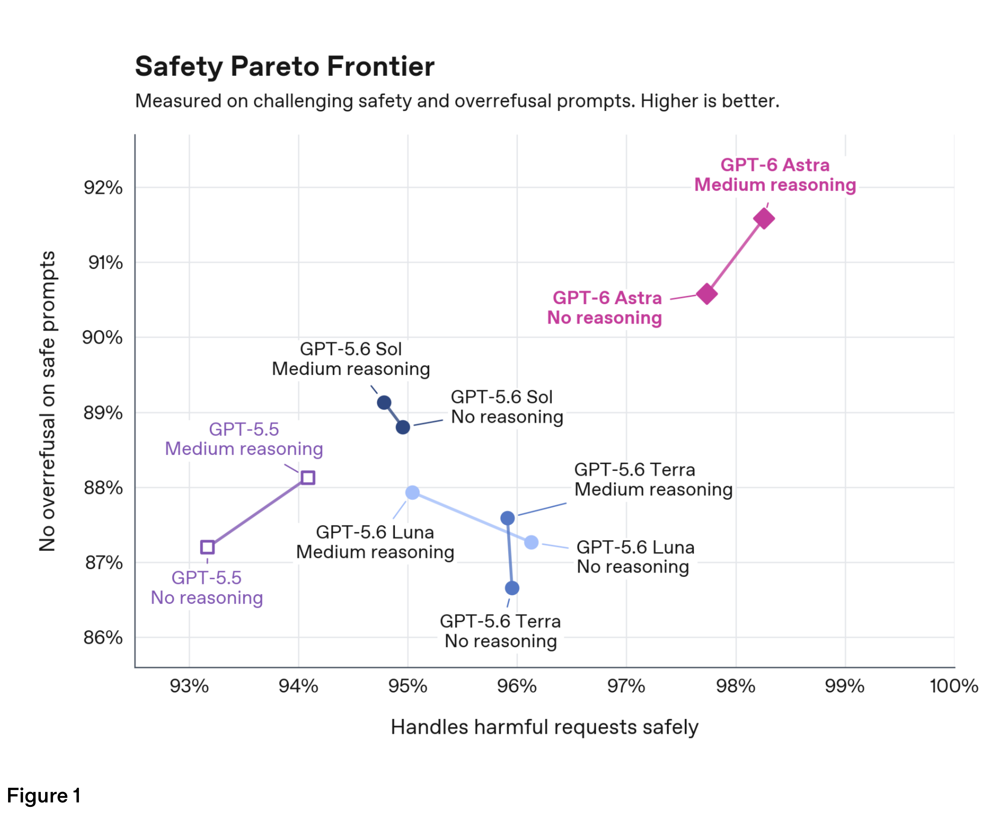
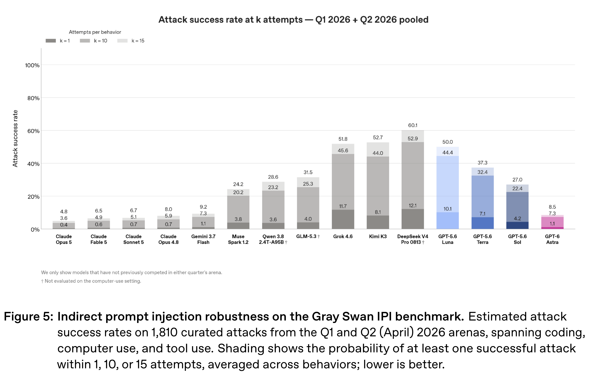

# GPT-6 Astra System Card

Models: GPT-6 Astra

[Source summaries](../README.md) · [中文索引](../README_CN.md)

[Original PDF](../../pdfs/openai/system-cards/gpt-6-astra-system-card.pdf#page=7) · [Official source](https://deploymentsafety.openai.com/gpt-6-astra)

PDF pages: 7 · Source text cross-checked with two extractors; not manually verified.

## 1 Safety Overview: GPT-6 Astra

Today, we are releasing GPT-6 Astra, the most capable model we have ever broadly deployed. Astra is our first model to reach the Critical level of cybersecurity capability under our Preparedness Framework.

The most important things to know about the safety of this launch are as follows:

## Core figures

[All figures and original captions](../../figures/openai/gpt-6-astra-system-card/README.md) · [中文](../../figures/openai/gpt-6-astra-system-card/README_CN.md)

### Safety Evaluation · Figure 1

Source page: 12 · [Original graphics PDF](../../figures/openai/gpt-6-astra-system-card/figure-01.pdf) · [High-resolution PNG](../../figures/openai/gpt-6-astra-system-card/figure-01.png)

Figure 1

### Safety Evaluation · Figure 5

Source page: 20 · [Original graphics PDF](../../figures/openai/gpt-6-astra-system-card/figure-02.pdf) · [High-resolution PNG](../../figures/openai/gpt-6-astra-system-card/figure-02.png)

Figure 5: Indirect prompt injection robustness on the Gray Swan IPI benchmark. Estimated attack
