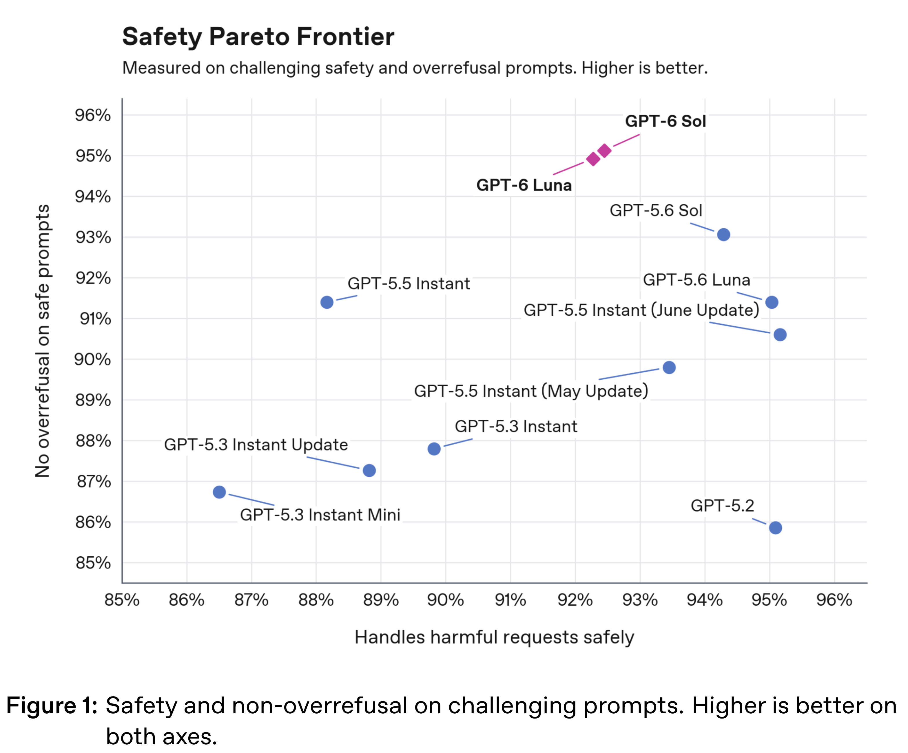
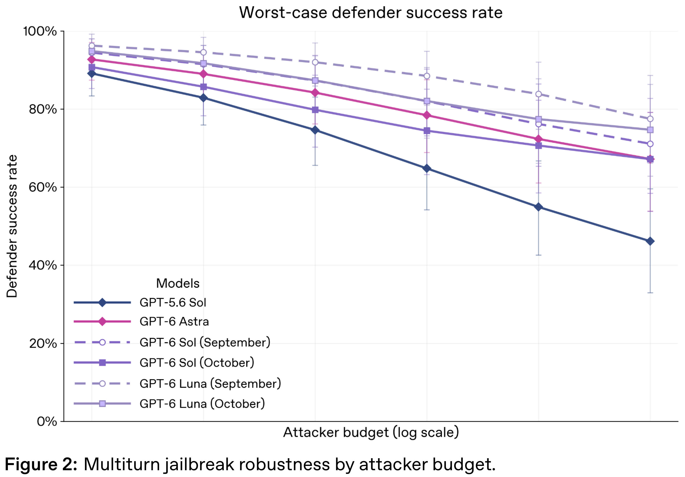
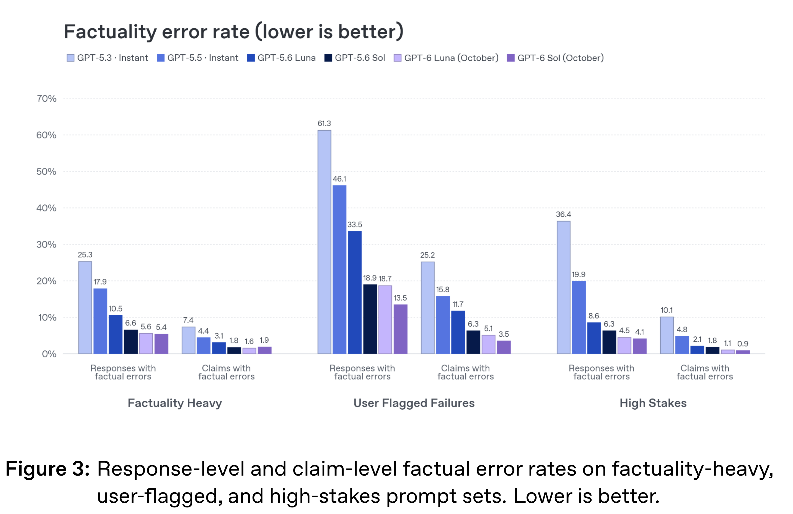

# GPT-6 Sol and GPT-6 Luna: October 2026 update

[Official source](https://deploymentsafety.openai.com/gpt-6-october)

## Introduction

We’re launching GPT-6 to everyone in ChatGPT, across free and paid plans globally. These models will replace GPT-5.6 Sol and GPT-5.6 Luna in ChatGPT. Users accessing GPT-6 Sol and GPT-6 Luna in Codex, and via ChatGPT Work, are still using previously released versions. In this system card, we distinguish these models by their month of release: October for the versions released today, and September for the versions that remain in use in Codex and Work. See our blog for details.

GPT-6 in ChatGPT incorporates Astra’s safety advances. We also updated the safety training to reflect real-world use and strengthen protections against high-risk misuse in cyber, biology, and violence.

We assess safety and alignment evaluations in aggregate, weighing improvements alongside the nature and severity of regressions. Compared with GPT-5.6 Sol and GPT-5.6 Luna in ChatGPT, GPT-6 showed stronger resistance to jailbreaks, including attacks that adapt across multiple turns, as well as reductions in dishonesty, deception, and circumvention of guardrails. For areas where our safety evaluations showed regressions, we conducted manual review of failures and adversarial red-team testing and found that the disallowed responses were generally low severity. System-level mitigations to reduce the likelihood of harm are detailed throughout this system card.

Under our Preparedness Framework, we are treating this October release of GPT-6 Sol and GPT-6 Luna as High capability in both Cybersecurity and Biological and Chemical domains. Neither one reaches our High threshold in AI Self-Improvement. Based on that assessment, we’ve implemented the same set of safeguards for GPT-6 Sol (October) and GPT-6 Luna (October) that are detailed in the GPT-5.6 System Card for GPT-5.6 Sol and GPT-5.6 Luna.

For all safety evaluations, such as disallowed content and mental health, we measure performance of our models at their lowest reasoning deployment settings in order to capture performance for the vast majority of usage. For capabilities assessments, we evaluate the models at their maximum reasoning effort to get an upper bound of capabilities.

## 2 Model Data and Training

Like OpenAI’s other models, GPT-6 models were trained on diverse datasets and filtered through our data processing pipeline, including to reduce per- sonal information. OpenAI reasoning models are trained to reason through reinforcement learning. These models are trained to think before they answer: they can produce a long internal chain of thought before responding to the user.

p. 5

Figure 1: Safety and non-overrefusal on challenging prompts. Higher is better on both axes.

p. 8

Figure 2: Multiturn jailbreak robustness by attacker budget.

p. 11

Figure 3: Response-level and claim-level factual error rates on factuality-heavy, user-flagged, and high-stakes prompt sets. Lower is better.

p. 16
