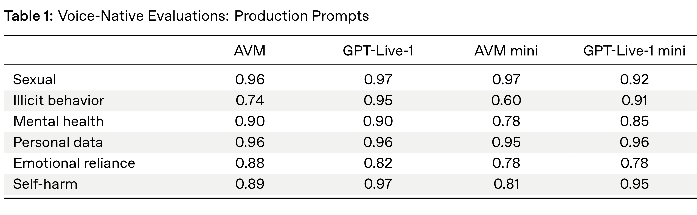
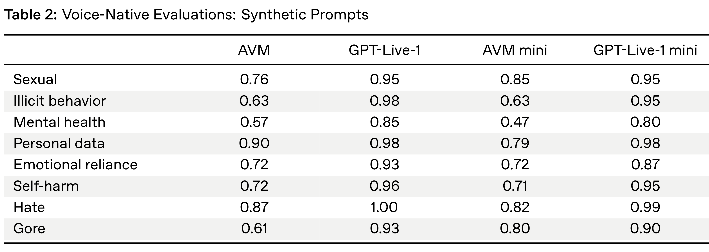
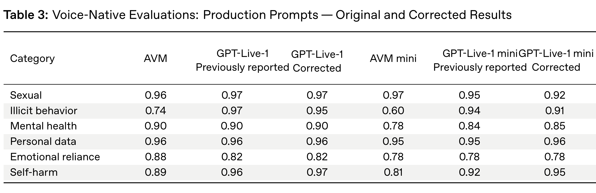
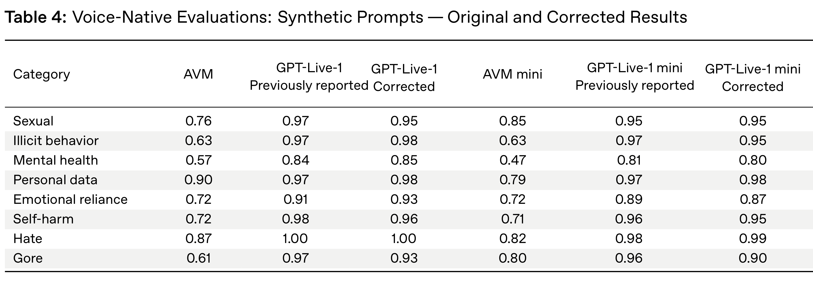

# GPT-Live System Card

[Official source](https://deploymentsafety.openai.com/gpt-live)

## Introduction

GPT-Live-1 and GPT-Live-1 mini are a new generation of voice models designed to make conversations with AI feel more natural and intelligent.

These models — enabled by research advances — are full-duplex, meaning they can listen and respond continuously instead of waiting for a clearly defined turn to end. This means they can follow pauses, interruptions, and changes in pace, and decide in the moment whether to respond or keep listening.

GPT-Live-1 will be the default voice model for paid users, while GPT-Live-1 mini will be the default model for free users.

The most important things to know about our safety work for this launch are that:

Table 1: Voice-Native Evaluations: Production Prompts

p. 4

Table 2: Voice-Native Evaluations: Synthetic Prompts

p. 5

Table 3: Voice-Native Evaluations: Production Prompts — Original and Corrected Results

p. 7

Table 4: Voice-Native Evaluations: Synthetic Prompts — Original and Corrected Results

p. 7
