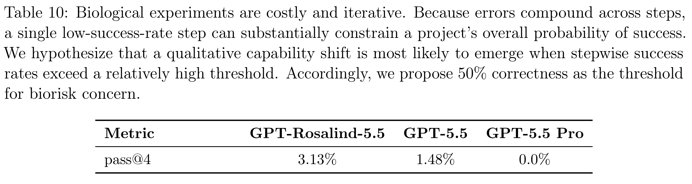

# GPT-Rosalind-5.5 System Card

[Official source](https://deploymentsafety.openai.com/gpt-rosalind-5-5)

## Introduction

GPT-Rosalind-5.5 is a new model in the GPT-Rosalind series, our frontier reasoning model built to support research across biology, drug discovery, and translational medicine. We are deploying it in research preview to trusted organizations, providing access limited to qualified scientists, research institutes and government partners who are working on beneficial uses and who have a strong security and governance posture.

GPT-Rosalind-5.5 is incrementally trained from GPT-5.5, our flagship reasoning model. Outside the biological domain, its capabilities are comparable to GPT-5.5 and it receives the same model- level safety training. We therefore have not provided evaluation results from those capabilities in this system card.

We worked with industry experts to design and evaluate GPT-Rosalind-5.5 on a series of benchmarks across medicinal chemistry, quantitative biology, wet lab protocol assistance, and applied life sciences research. Beneficial biological capabilities, as expected, exceed those of the regular GPT-5.5 model, often while expending fewer tokens.

Under our Preparedness Framework, the Preparedness evaluations in the Biological and Chemical domain met our threshold for High capability while falling below the threshold for Critical. Cybersecurity capabilities were found to be at or below the level of GPT-5.5. Because GPT- Rosalind-5.5 was trained on additional biology data unrelated to AI self-improvement, we rely on GPT-5.5’s existing Preparedness assessment for AI Self-Improvement, where GPT-5.5 did not meet the threshold for High capability. Our Safety Advisory Group approved the safeguards plan for this release, finding that it sufficiently mitigates the associated risks of severe harm.

Below we describe the incremental biological capability findings for GPT-Rosalind-5.5 compared with GPT-5.5, and describe the differences in safeguard approach for this deployment compared with the primary GPT-5.5 model.

Table 10: Biological experiments are costly and iterative. Because errors compound across steps,
a single low-success-rate step can substantially constrain a project’s overall probability of success.
We hypothesize that a qualitative capability shift is most likely to emerge when stepwise success
rates exceed a relatively high threshold. Accordingly, we propose 50% correctness as the threshold
for biorisk concern.

p. 8
