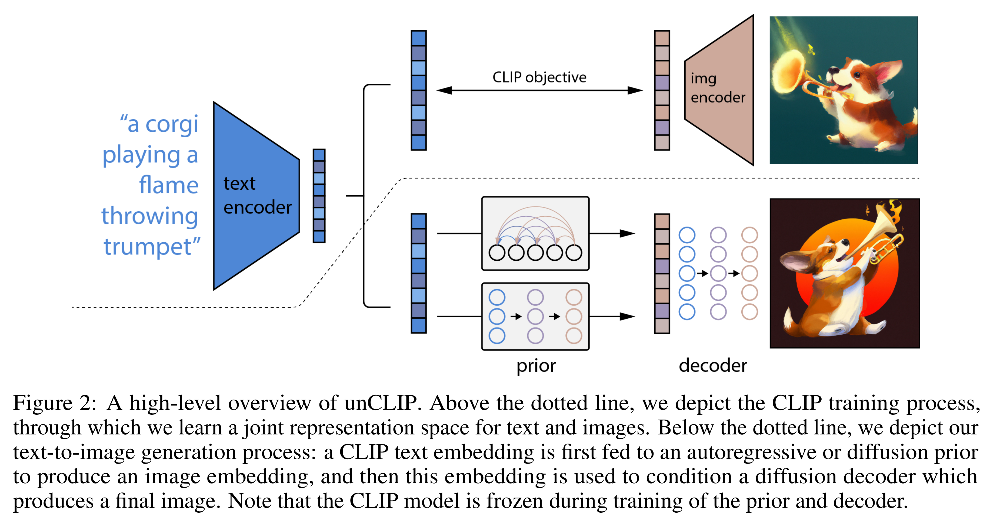

# Hierarchical Text-Conditional Image Generation with CLIP Latents

[Official source](https://arxiv.org/abs/2204.06125)

## Abstract

Contrastive models like CLIP have been shown to learn robust representations of images that capture both semantics and style. To leverage these representations for image generation, we propose a two-stage model: a prior that generates a CLIP image embedding given a text caption, and a decoder that generates an image conditioned on the image embedding. We show that explicitly generating image representations improves image diversity with minimal loss in photorealism and caption similarity. Our decoders conditioned on image representations can also produce variations of an image that preserve both its semantics and style, while varying the non-essential details absent from the image representation. Moreover, the joint embedding space of CLIP enables language-guided image manipulations in a zero-shot fashion. We use diffusion models for the decoder and experiment with both autoregressive and diffusion models for the prior, finding that the latter are computationally more efficient and produce higher-quality samples.

Figure 2: A high-level overview of unCLIP. Above the dotted line, we depict the CLIP training process, through which we learn a joint representation space for text and images. Below the dotted line, we depict our text-to-image generation process: a CLIP text embedding is first fed to an autoregressive or diffusion prior to produce an image embedding, and then this embedding is used to condition a diffusion decoder which produces a final image. Note that the CLIP model is frozen during training of the prior and decoder.

p. 3
