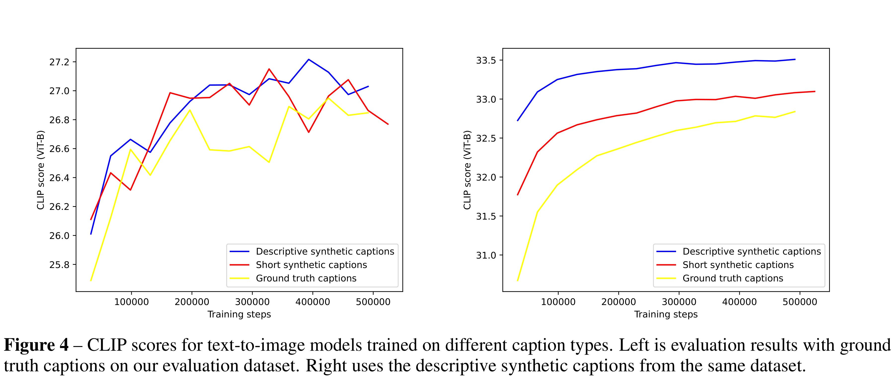

# Improving Image Generation with Better Captions

[Official source](https://openai.com/index/dall-e-3/)

## Abstract

We show that prompt following abilities of text-to-image models can be substantially improved by training on highly descriptive generated image captions. Existing text-to-image models struggle to follow detailed image descriptions and often ignore words or confuse the meaning of prompts. We hypothesize that this issue stems from noisy and inaccurate image captions in the training dataset. We address this by training a bespoke image captioner and use it to recaption the training dataset. We then train several text-to-image models and find that training on these synthetic captions reliably improves prompt following ability. Finally, we use these findings to build DALL-E 3: a new text-to-image generation system, and benchmark its performance on an evaluation designed to measure prompt following, coherence, and aesthetics, finding that it compares favorably to competitors. We publish samples and code for these evaluations so that future research can continue optimizing this important aspect of text-to-image systems.

Figure 4 – CLIP scores for text-to-image models trained on different caption types. Left is evaluation results with ground truth captions on our evaluation dataset. Right uses the descriptive synthetic captions from the same dataset.

p. 8
