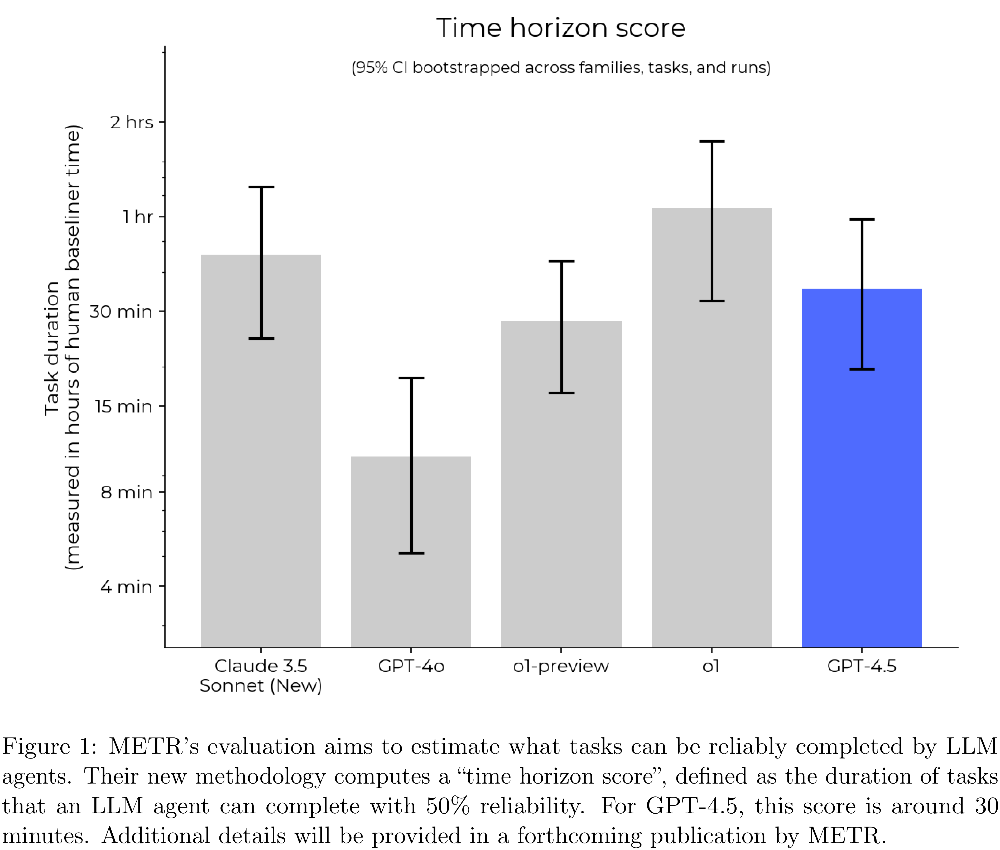

# OpenAI GPT-4.5 System Card

[Official source](https://openai.com/index/gpt-4-5-system-card/)

## Introduction

We’re releasing a research preview of OpenAI GPT-4.5, our largest and most knowledgeable model yet. Building on GPT-4o, GPT-4.5 scales pre-training further and is designed to be more general-purpose than our powerful STEM-focused reasoning models. We trained it using new supervision techniques combined with traditional methods like supervised fine-tuning (SFT) and reinforcement learning from human feedback (RLHF), similar to those used for GPT-4o. We conducted extensive safety evaluations prior to deployment and did not find any significant increase in safety risk compared to existing models.

Early testing shows that interacting with GPT-4.5 feels more natural. Its broader knowledge base, stronger alignment with user intent, and improved emotional intelligence make it well-suited for tasks like writing, programming, and solving practical problems - with fewer hallucinations.

We’re sharing GPT-4.5 as a research preview to better understand its strengths and limitations. We’re still exploring its capabilities and are eager to see how people use it in ways we might not have expected.

This system card outlines how we built and trained GPT-4.5, evaluated its capabilities, and strengthened safety, following OpenAI’s safety process and Preparedness Framework.

Figure 1: METR’s evaluation aims to estimate what tasks can be reliably completed by LLM agents. Their new methodology computes a “time horizon score”, defined as the duration of tasks that an LLM agent can complete with 50% reliability. For GPT-4.5, this score is around 30 minutes. Additional details will be provided in a forthcoming publication by METR.

p. 7
