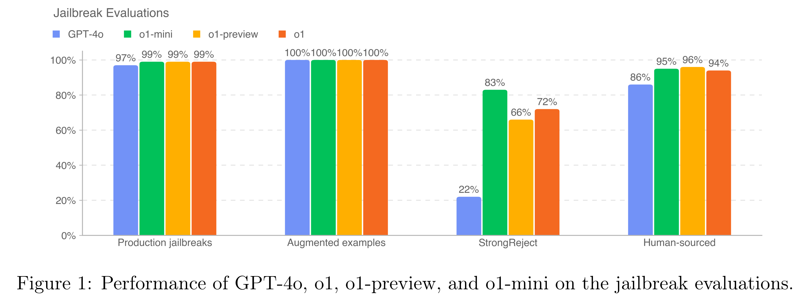

# OpenAI o1 System Card

[Official source](https://openai.com/index/openai-o1-system-card/)

## Introduction

The o1 model series is trained with large-scale reinforcement learning to reason using chain of thought. These advanced reasoning capabilities provide new avenues for improving the safety and robustness of our models. In particular, our models can reason about our safety policies in context when responding to potentially unsafe prompts, through deliberative alignment[1]1. This leads to state-of-the-art performance on certain benchmarks for risks such as generating illicit advice, choosing stereotyped responses, and succumbing to known jailbreaks. Training models to incorporate a chain of thought before answering has the potential to unlock substantial benefits, while also increasing potential risks that stem from heightened intelligence. Our results underscore the need for building robust alignment methods, extensively stress-testing their efficacy, and maintaining meticulous risk management protocols. This report outlines the safety work carried out for the OpenAI o1 and OpenAI o1-mini models, including safety evaluations, external red teaming, and Preparedness Framework evaluations.

Figure 1: Performance of GPT-4o, o1, o1-preview, and o1-mini on the jailbreak evaluations.

p. 5
