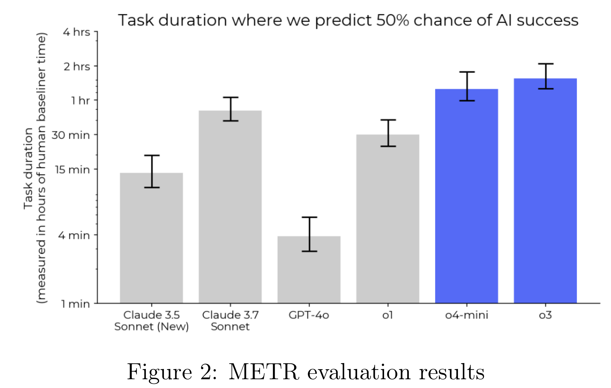

# OpenAI o3 and o4-mini System Card

[Official source](https://deploymentsafety.openai.com/o3)

## Introduction

OpenAI o3 and OpenAI o4-mini combine state-of-the-art reasoning with full tool capabilities — web browsing, Python, image and file analysis, image generation, canvas, automations, file search, and memory. These models excel at solving complex math, coding, and scientific challenges while demonstrating strong visual perception and analysis. The models use tools in their chains of thought to augment their capabilities; for example, cropping or transforming images, searching the web, or using Python to analyze data during their thought process.

The OpenAI o-series models are trained with large-scale reinforcement learning on chains of thought. These advanced reasoning capabilities provide new avenues for improving the safety and robustness of our models. In particular, our models can reason about our safety policies in context when responding to potentially unsafe prompts, through deliberative alignment [1]1.

This is the first launch and system card to be released under Version 2 of our Preparedness Framework. OpenAI’s Safety Advisory Group (SAG) reviewed the results of our Preparedness evaluations and determined that OpenAI o3 and o4-mini do not reach the High threshold in any of our three Tracked Categories: Biological and Chemical Capability, Cybersecurity, and AI Self-improvement. We describe these evaluations below, and provide an update on our work to mitigate risks in these areas.

Figure 2: METR evaluation results

p. 9
