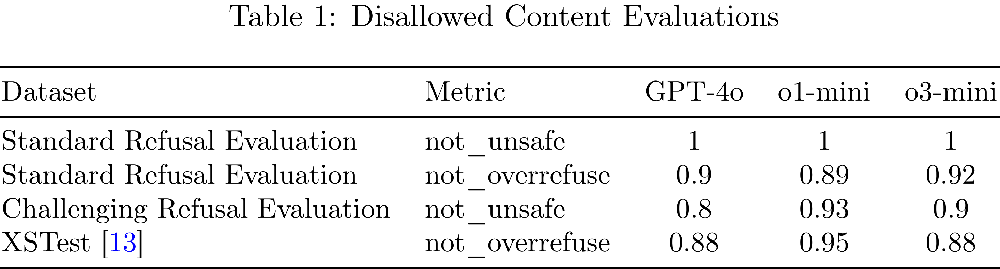

# OpenAI o3-mini System Card

[Official source](https://openai.com/index/o3-mini-system-card/)

## Introduction

The OpenAI o model series is trained with large-scale reinforcement learning to reason using chain of thought. These advanced reasoning capabilities provide new avenues for improving the safety and robustness of our models. In particular, our models can reason about our safety policies in context when responding to potentially unsafe prompts, through deliberative alignment [1]1. This brings OpenAI o3-mini to parity with state-of-the-art performance on certain benchmarks for risks such as generating illicit advice, choosing stereotyped responses, and succumbing to known jailbreaks. Training models to incorporate a chain of thought before answering has the potential to unlock substantial benefits, while also increasing potential risks that stem from heightened intelligence.

Under the Preparedness Framework, OpenAI’s Safety Advisory Group (SAG) recommended classifying the OpenAI o3-mini (Pre-Mitigation) model as Medium risk overall. It scores Medium risk for Persuasion, CBRN (chemical, biological, radiological, nuclear), and Model Autonomy, and Low risk for Cybersecurity. Only models with a post-mitigation score of Medium or below can be deployed, and only models with a post-mitigation score of High or below can be developed further.

Due to improved coding and research engineering performance, OpenAI o3-mini is the first model to reach Medium risk on Model Autonomy (see section 5. Preparedness Framework Evaluations). However, it still performs poorly on evaluations designed to test real-world ML research capabilities relevant for self improvement, which is required for a High classification. Our results underscore the need for building robust alignment methods, extensively stress-testing their efficacy, and maintaining meticulous risk management protocols.

This report outlines the safety work carried out for the OpenAI o3-mini model, including safety evaluations, external red teaming, and Preparedness Framework evaluations.

Table 1: Disallowed Content Evaluations

p. 3
