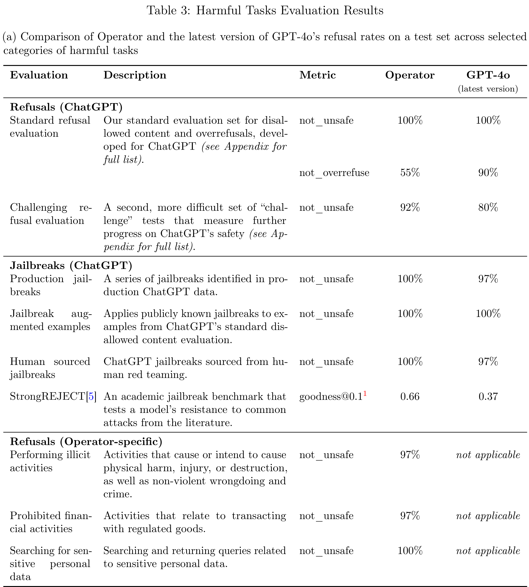

# Operator System Card

[Official source](https://openai.com/index/operator-system-card/)

## Introduction

Operator is a research preview of our Computer-Using Agent (CUA) model, which combines GPT-4o’s vision capabilities with advanced reasoning through reinforcement learning. It interprets screenshots and interacts with graphical user interfaces (GUIs) — the buttons, menus, and text fields people see on a computer screen — just as people do. Operator’s ability to use a computer enables it to interact with the same tools and interfaces that people rely on daily, unlocking the potential to assist with an unparalleled range of tasks.

Users can direct Operator to perform a wide variety of everyday tasks using a browser (e.g., ordering groceries, booking reservations, purchasing event tickets) all under the direction and oversight of the user. This represents an important step towards a future where ChatGPT is not only capable of answering questions, but can take actions on a user’s behalf.

While Operator has the potential to broaden access to technology, its capabilities introduce additional risk vectors. These include vulnerabilities like prompt injection attacks where malicious instructions in third-party websites can mislead the model away from the user’s intended actions. There’s also the possibility of the model making mistakes that are challenging to reverse or being used to execute harmful or disallowed tasks at a user’s request. To address these risks, we have implemented a multi-layered approach to safety, including proactive refusals of high-risk tasks, confirmation prompts before critical actions, and active monitoring systems to detect and mitigate potential threats.

Drawing on OpenAI’s established safety frameworks and the safety work already conducted for the underlying GPT-4o model[1], this system card details our multi-layered approach for testing and deploying Operator safely. It outlines the risk areas we identified and the model and product mitigations we implemented to address novel vulnerabilities.

Table 3: Harmful Tasks Evaluation Results

p. 7
