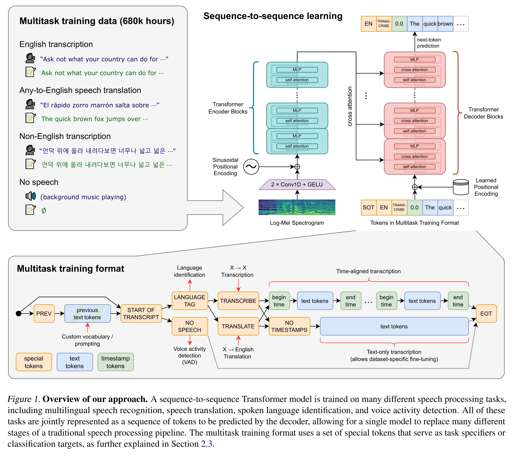

# Robust Speech Recognition via Large-Scale Weak Supervision

[Official source](https://github.com/openai/whisper)

## Abstract

We study the capabilities of speech processing systems trained simply to predict large amounts of transcripts of audio on the internet. When scaled to 680,000 hours of multilingual and multitask supervision, the resulting models generalize well to standard benchmarks and are often competitive with prior fully supervised results but in a zero-shot transfer setting without the need for any fine-tuning. When compared to humans, the models approach their accuracy and robustness. We are releasing models and inference code to serve as a foundation for further work on robust speech processing.

Figure 1. Overview of our approach. A sequence-to-sequence Transformer model is trained on many different speech processing tasks, including multilingual speech recognition, speech translation, spoken language identification, and voice activity detection. All of these tasks are jointly represented as a sequence of tokens to be predicted by the decoder, allowing for a single model to replace many different stages of a traditional speech processing pipeline. The multitask training format uses a set of special tokens that serve as task specifiers or classification targets, as further explained in Section 2.3.

p. 4
