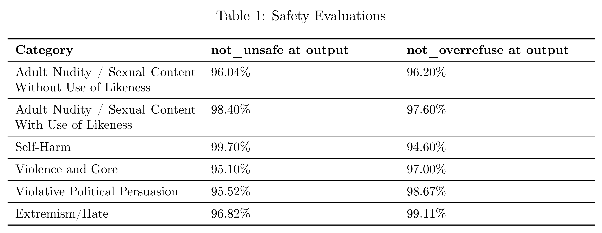

# Sora 2 System Card

[Official source](https://deploymentsafety.openai.com/sora-2)

## 1 Overview of Sora 2

Sora 2 is our new state of the art video and audio generation model. Building on the foundation of Sora, this new model introduces capabilities that have been difficult for prior video models to achieve– such as more accurate physics, sharper realism, synchronized audio, enhanced steerability, and an expanded stylistic range. The model follows user direction with high fidelity, enabling the creation of videos that are both imaginative and grounded in real-world dynamics. Sora 2 expands the toolkit for storytelling and creative expression, while also serving as a step toward models that can more accurately simulate the complexity of the physical world. Sora 2 will be available via sora.com, in a new standalone iOS Sora app, and in the future it will be available via our API.

Sora 2’s advanced capabilities require consideration of new potential risks, including nonconsensual use of likeness or misleading generations. To address these, we worked with internal red teamers to identify new challenges and inform corresponding mitigations. We’re taking an iterative approach to safety, focusing on areas where context is especially important or where risks are still emerging and are not fully understood.

Our iterative deployment includes rolling out initial access to Sora 2 via limited invitations, restricting the use of image uploads that feature a photorealistic person and all video uploads, and placing stringent safeguards and moderation thresholds on content involving minors. We’ll continue to learn from how people use Sora 2 and refine the system to balance safety while maximizing creative potential. This system card describes the model’s capabilities, potential risks, and the safety measures OpenAI has developed for a safe deployment of Sora 2.

Table 1: Safety Evaluations

p. 7
