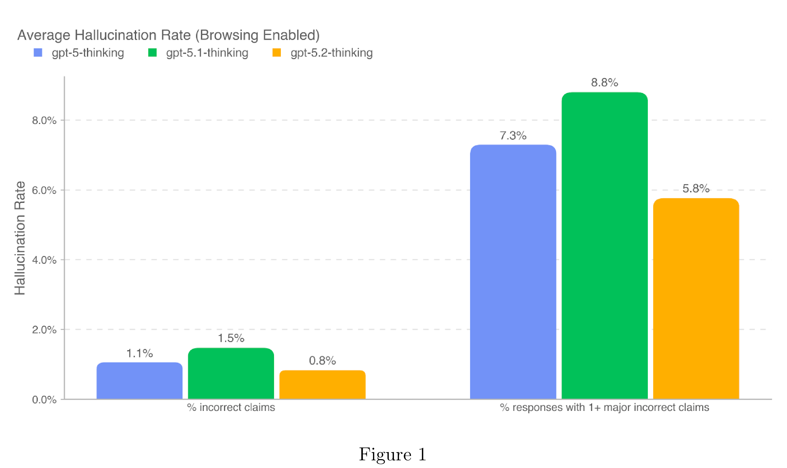
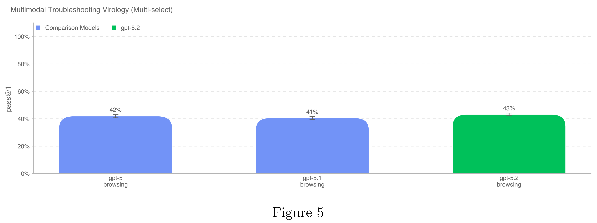

# Update to GPT-5 System Card: GPT-5.2

[Official source](https://deploymentsafety.openai.com/gpt-5-2)

## Introduction

GPT-5.2 is the latest model family in the GPT-5 series, and explained in our blog. The comprehensive safety mitigation approach for these models is largely the same as that described in the GPT-5 System Card and GPT-5.1 System Card.

In this card we also refer to GPT-5.2 Instant as gpt-5.2-instant and GPT-5.2 Thinking as gpt-5.2-thinking.

Figure 1

p. 7

Figure 5

p. 13
