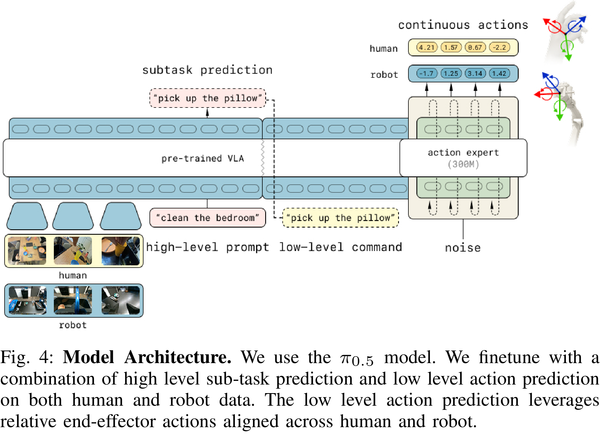
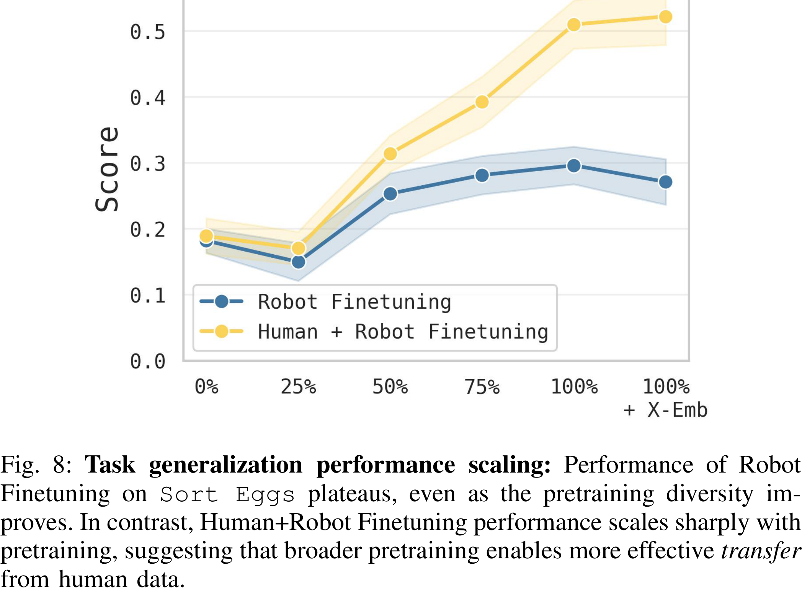

# Emergence of Human to Robot Transfer in Vision-Language-Action Models

[Official source](https://arxiv.org/abs/2512.22414)

## Abstract—

Vision-language-action (VLA) models can enable broad open world generalization, but require large and diverse datasets. It is appealing to consider whether some of this data can come from human videos, which cover diverse real-world situations and are easy to obtain. However, it is difficult to train VLAs with human videos alone, and establishing a mapping between humans and robots requires manual engineering and presents a major research challenge. Drawing inspiration from advances in large language models, where the ability to learn from diverse supervision emerges with scale, we ask whether a similar phenomenon holds for VLAs that incorporate human video data. We introduce a simple co-training recipe, and find that human-to-robot transfer emerges once the VLA is pre- trained on sufficient scenes, tasks, and embodiments. Our analysis suggests that this emergent capability arises because diverse pretraining produces embodiment-agnostic representations for human and robot data. We validate these findings through a series of experiments probing human to robot skill transfer and find that with sufficiently diverse robot pre-training our method can nearly double the performance on generalization settings seen only in human data.

Fig. 4: Model Architecture. We use the π0.5 model. We finetune with a combination of high level sub-task prediction and low level action prediction on both human and robot data. The low level action prediction leverages relative end-effector actions aligned across human and robot.

p. 4

Fig. 8: Task generalization performance scaling: Performance of Robot Finetuning on Sort Eggs plateaus, even as the pretraining diversity im- proves. In contrast, Human+Robot Finetuning performance scales sharply with pretraining, suggesting that broader pretraining enables more effective transfer from human data.

p. 6
