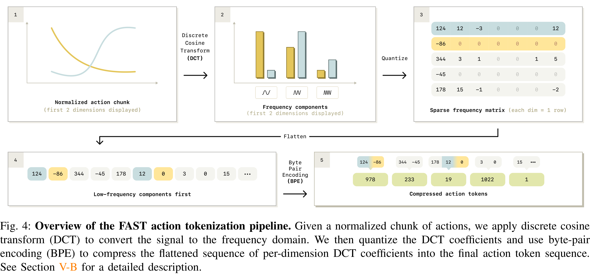
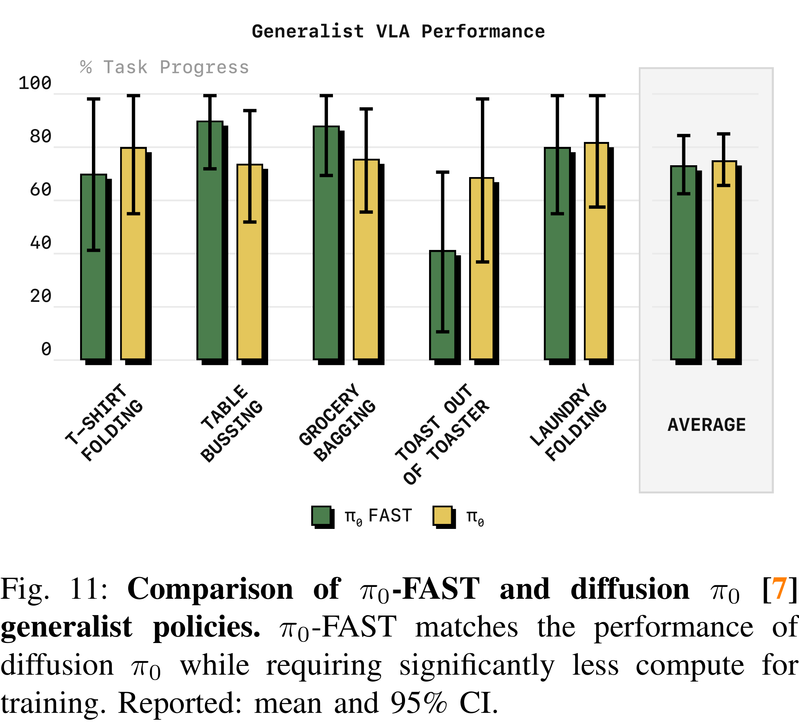

# FAST: Efficient Action Tokenization for Vision-Language-Action Models

[Official source](https://arxiv.org/abs/2501.09747)

## Abstract—

Autoregressive

as Transformer-based vision-language action (VLA) policies, can be tremendously effective for capturing complex and generalizable robotic behaviors. However, such models require us to choose a tokenization of our continuous action signals, which determines how the discrete symbols predicted by the model map to continuous robot actions. We find that current approaches for robot action tokenization, based on simple per-dimension, per-timestep binning schemes, typically perform poorly when learning dexterous skills from high-frequency robot data. To address this challenge, we propose a new compression-based tokenization scheme for robot actions, based on the discrete cosine transform. Our tokenization approach, Frequency-space Action Sequence Tokenization (FAST), enables us to train autoregressive VLAs for highly dexterous and high-frequency tasks where standard discretization methods fail completely. Based on FAST, we release FAST+, a universal robot action tokenizer, trained on 1M real robot action trajectories. It can be used as a black-box tokenizer for a wide range of robot action sequences, with diverse action spaces and control frequencies. Finally, we show that, when combined with the π0 VLA, our method can scale to training on 10k hours of robot data and match the performance of diffusion VLAs, while reducing training time by up to 5x.

Fig. 4: Overview of the FAST action tokenization pipeline. Given a normalized chunk of actions, we apply discrete cosine transform (DCT) to convert the signal to the frequency domain. We then quantize the DCT coefficients and use byte-pair encoding (BPE) to compress the flattened sequence of per-dimension DCT coefficients into the final action token sequence. See Section V-B for a detailed description.

p. 5

Fig. 11: Comparison of π0-FAST and diffusion π0 [7] generalist policies. π0-FAST matches the performance of diffusion π0 while requiring significantly less compute for training. Reported: mean and 95% CI.

p. 10
