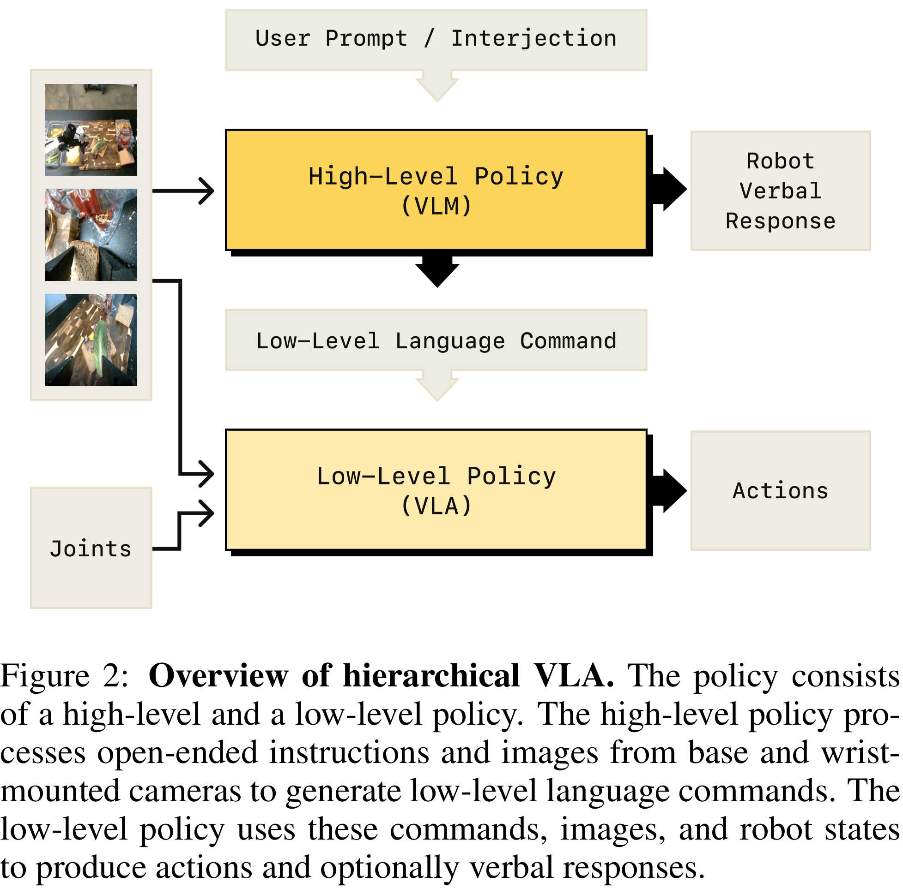
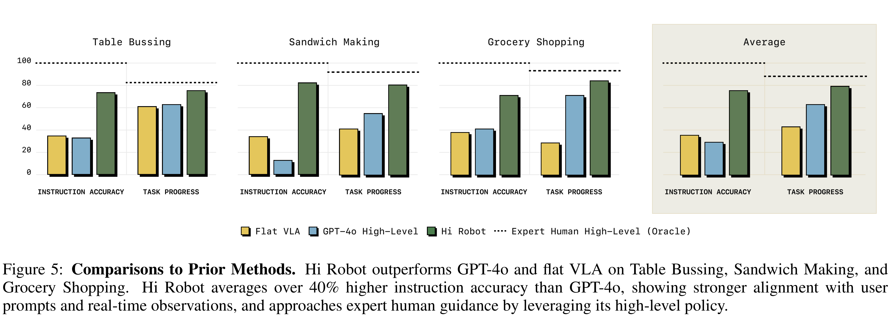

# Hi Robot: Open-Ended Instruction Following with Hierarchical Vision-Language-Action Models

[Official source](https://arxiv.org/abs/2502.19417)

## Abstract

Generalist robots that can perform a range of dif- ferent tasks in open-world settings must be able to not only reason about the steps needed to ac- complish their goals, but also process complex instructions, prompts, and even feedback dur- ing task execution. Intricate instructions (e.g., “Could you make me a vegetarian sandwich?” or “I don’t like that one”) require not just the ability to physically perform the individual steps, but the ability to situate complex commands and feedback in the physical world. In this work, we describe a system that uses vision-language mod- els in a hierarchical structure, first reasoning over complex prompts and user feedback to deduce the most appropriate next step to fulfill the task, and then performing that step with low-level ac- tions. In contrast to direct instruction following methods that can fulfill simple commands (“pick up the cup”), our system can reason through complex prompts and incorporate situated feed- back during task execution (“that’s not trash”). We evaluate our system across three robotic plat- forms, including single-arm, dual-arm, and dual- arm mobile robots, demonstrating its ability to handle tasks such as cleaning messy tables, mak- ing sandwiches, and grocery shopping.

Figure 2: Overview of hierarchical VLA. The policy consists of a high-level and a low-level policy. The high-level policy pro- cesses open-ended instructions and images from base and wrist- mounted cameras to generate low-level language commands. The low-level policy uses these commands, images, and robot states to produce actions and optionally verbal responses.

p. 4

Figure 5: Comparisons to Prior Methods. Hi Robot outperforms GPT-4o and flat VLA on Table Bussing, Sandwich Making, and Grocery Shopping. Hi Robot averages over 40% higher instruction accuracy than GPT-4o, showing stronger alignment with user prompts and real-time observations, and approaches expert human guidance by leveraging its high-level policy.

p. 7
