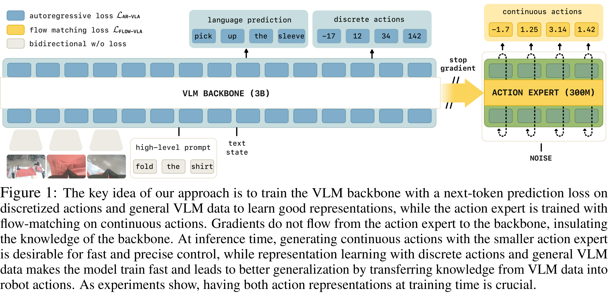
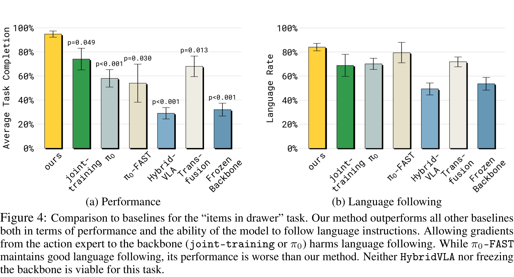

# Knowledge Insulating Vision-Language-Action Models: Train Fast, Run Fast, Generalize Better

[Official source](https://arxiv.org/abs/2505.23705)

## Abstract

Vision-language-action (VLA) models provide a powerful approach to training control policies for physical systems, such as robots, by combining end-to-end learning with transfer of semantic knowledge from web-scale vision-language model (VLM) training. However, the constraints of real-time control are often at odds with the design of VLMs: the most powerful VLMs have tens or hundreds of billions of parameters, presenting an obstacle to real-time inference, and operate on discrete tokens rather than the continuous-valued outputs that are required for controlling robots. To address this challenge, recent VLA models have used specialized modules for efficient continuous control, such as action experts or continuous output heads, which typically require adding new untrained parameters to the pretrained VLM backbone. While these modules improve real-time and control capabilities, it remains an open question whether they preserve or degrade the semantic knowledge contained in the pretrained VLM, and what effect they have on the VLA training dynamics. In this paper, we study this question in the context of VLAs that include a continuous diffusion or flow matching action expert, showing that naively including such experts significantly harms both training speed and knowledge transfer. We provide an extensive analysis of various design choices, their impact on performance and knowledge transfer, and propose a technique for insulating the VLM backbone during VLA training that mitigates this issue. Videos are available at https://pi.website/research/knowledge_insulation.

Figure 1: The key idea of our approach is to train the VLM backbone with a next-token prediction loss on discretized actions and general VLM data to learn good representations, while the action expert is trained with flow-matching on continuous actions. Gradients do not flow from the action expert to the backbone, insulating the knowledge of the backbone. At inference time, generating continuous actions with the smaller action expert is desirable for fast and precise control, while representation learning with discrete actions and general VLM data makes the model train fast and leads to better generalization by transferring knowledge from VLM data into robot actions. As experiments show, having both action representations at training time is crucial.

p. 2

Figure 4: Comparison to baselines for the “items in drawer” task. Our method outperforms all other baselines both in terms of performance and the ability of the model to follow language instructions. Allowing gradients from the action expert to the backbone (joint-training or π0) harms language following. While π0-FAST maintains good language following, its performance is worse than our method. Neither HybridVLA nor freezing the backbone is viable for this task.

p. 8
