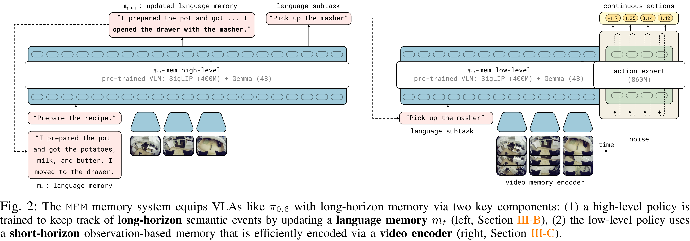
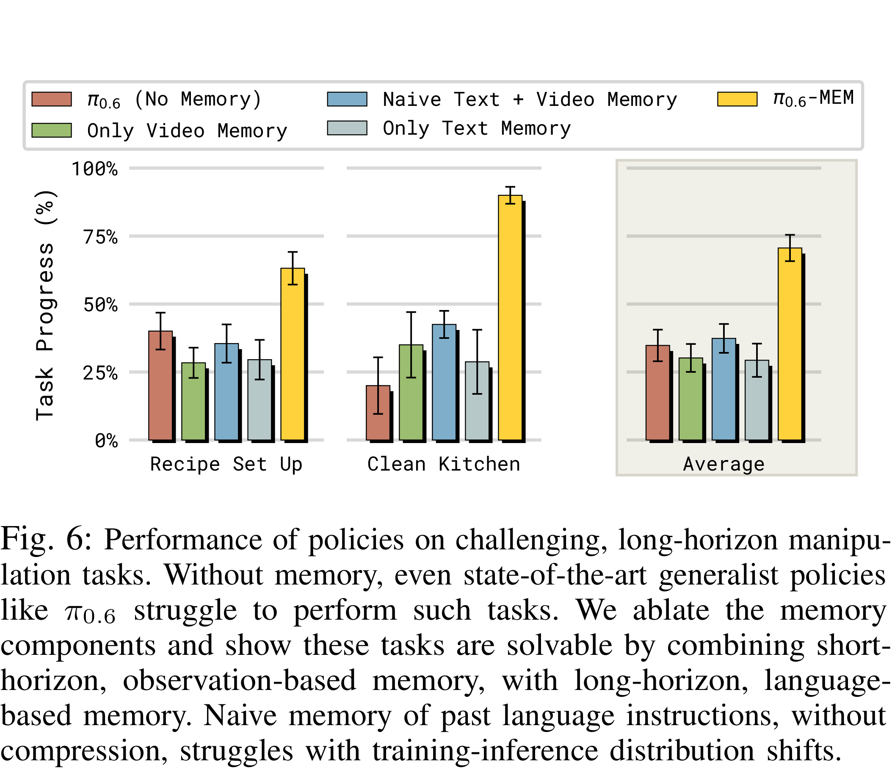

# MEM: Multi-Scale Embodied Memory for Vision Language Action Models

[Official source](https://www.pi.website/research/memory)

## Abstract—

Conventionally, memory in end-to-end robotic learn- ing involves inputting a sequence of past observations into the learned policy. However, in complex multi-stage real-world tasks, the robot’s memory must represent past events at multiple levels of granularity: from long-term memory that captures abstracted semantic concepts (e.g., a robot cooking dinner should remember which stages of the recipe are already done) to short-term memory that captures recent events and compensates for occlusions (e.g., a robot remembering the object it wants to pick up once its arm occludes it). In this work, our main insight is that an effective memory architecture for long-horizon robotic control should combine multiple modalities to capture these different levels of abstraction. We introduce Multi-Scale Embodied Memory (MEM), an approach for mixed-modal long-horizon memory in robot policies. MEM combines video-based short-horizon memory, compressed via a video encoder, with text-based long-horizon memory. Together, they enable robot policies to perform tasks that span up to fifteen minutes, like cleaning up a kitchen, or preparing a grilled cheese sandwich. Additionally, we find that memory enables MEM policies to intelligently adapt manipulation strategies in-context.

Fig. 2: The MEM memory system equips VLAs like π0.6 with long-horizon memory via two key components: (1) a high-level policy is trained to keep track of long-horizon semantic events by updating a language memory mt (left, Section III-B), (2) the low-level policy uses a short-horizon observation-based memory that is efficiently encoded via a video encoder (right, Section III-C).

p. 4

Fig. 6: Performance of policies on challenging, long-horizon manipu- lation tasks. Without memory, even state-of-the-art generalist policies like π0.6 struggle to perform such tasks. We ablate the memory components and show these tasks are solvable by combining short- horizon, observation-based memory, with long-horizon, language- based memory. Naive memory of past language instructions, without compression, struggles with training-inference distribution shifts.

p. 6
