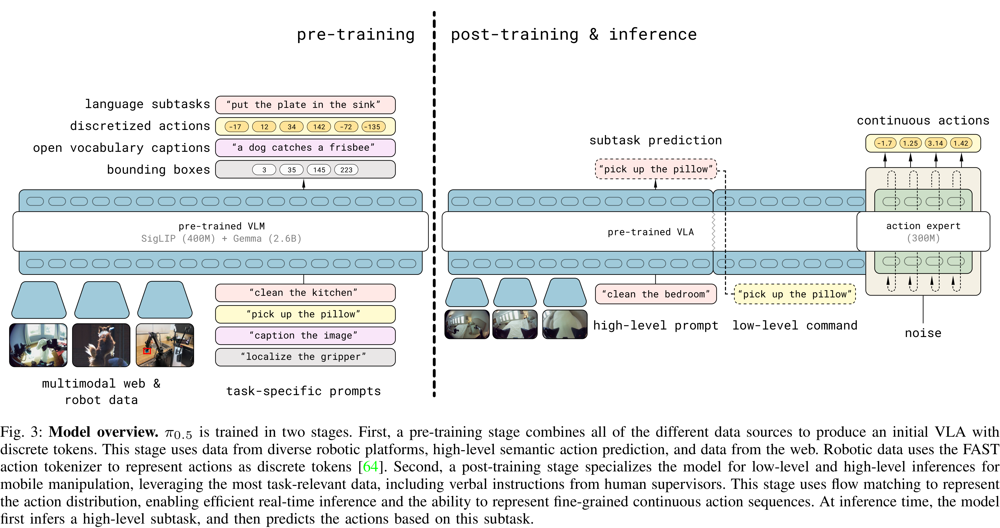
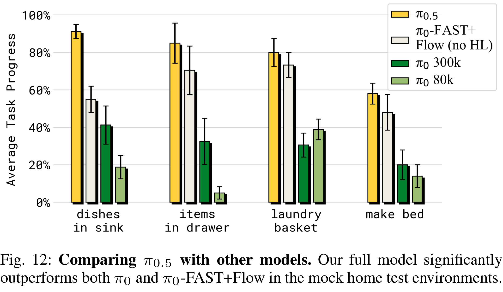

# π0.5: a Vision-Language-Action Model with Open-World Generalization

[Official source](https://arxiv.org/abs/2504.16054)

## Abstract—

In order for robots to be useful, they must perform practically relevant tasks in the real world, outside of the lab. While vision-language-action (VLA) models have demonstrated impressive results for end-to-end robot control, it remains an open question how far such models can generalize in the wild. We describe π0.5, a new model based on π0 that uses co-training on heterogeneous tasks to enable broad generalization. π0.5 uses data from multiple robots, high-level semantic prediction, web data, and other sources to enable broadly generalizable real-world robotic manipulation. Our system uses a combination of co-training and hybrid multi-modal examples that combine image observations, language commands, object detections, semantic subtask prediction, and low-level actions. Our experiments show that this kind of knowledge transfer is essential for effective generalization, and we demonstrate for the first time that an end-to-end learning-enabled robotic system can perform long-horizon and dexterous manipulation skills, such as cleaning a kitchen or bedroom, in entirely new homes.

Fig. 3: Model overview. π0.5 is trained in two stages. First, a pre-training stage combines all of the different data sources to produce an initial VLA with discrete tokens. This stage uses data from diverse robotic platforms, high-level semantic action prediction, and data from the web. Robotic data uses the FAST action tokenizer to represent actions as discrete tokens [64]. Second, a post-training stage specializes the model for low-level and high-level inferences for mobile manipulation, leveraging the most task-relevant data, including verbal instructions from human supervisors. This stage uses flow matching to represent the action distribution, enabling efficient real-time inference and the ability to represent fine-grained continuous action sequences. At inference time, the model first infers a high-level subtask, and then predicts the actions based on this subtask.

p. 4

Fig. 12: Comparing π0.5 with other models. Our full model significantly outperforms both π0 and π0-FAST+Flow in the mock home test environments.

p. 10
