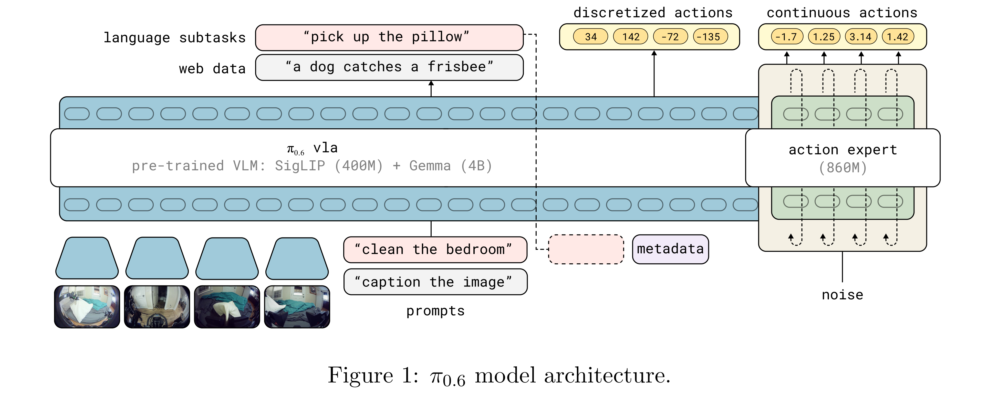
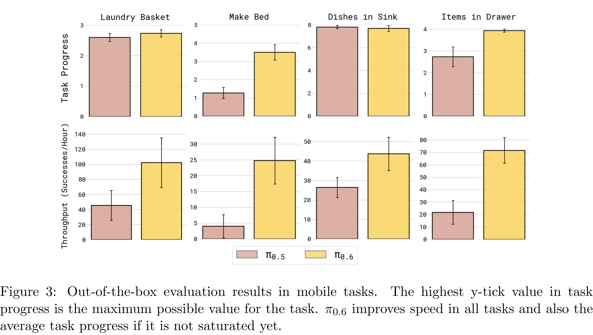

# π0.6 Model Card

[Official source](https://website.pi-asset.com/pi06star/PI06_model_card.pdf)

## Introduction

We introduce π0.6, our newest vision-language-action (VLA) model that builds on top of π0.5 [2] and achieves stronger performance across tasks. π0.6 preserves the hierarchical design of π0.5, providing high-level subtask prediction and low-level action generation. It incorporates a few changes involving the pre-trained VLM backbone and prompt design (Section 2), as well as the training datasets (Section 3). Section 4 analyzes the improvement in performance of π0.6 compared to π0.5 on a range of tasks that require dexterity and generalization. These experiments evaluate each model out of the box, without finetuning. This model has also been adopted as the base model for π∗ 0.6 [7] where it is further improved through real-world reinforcement learning.

Figure 1: π0.6 model architecture.

p. 2

Figure 3: Out-of-the-box evaluation results in mobile tasks. The highest y-tick value in task progress is the maximum possible value for the task. π0.6 improves speed in all tasks and also the average task progress if it is not saturated yet.

p. 3
