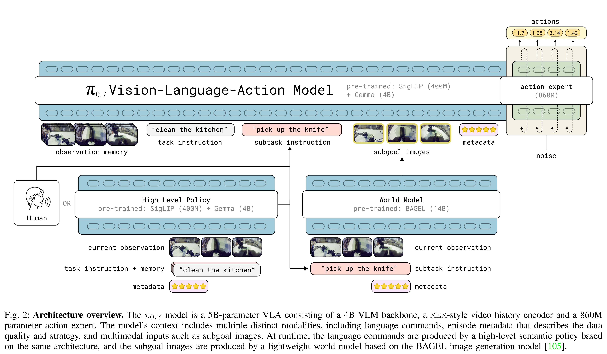
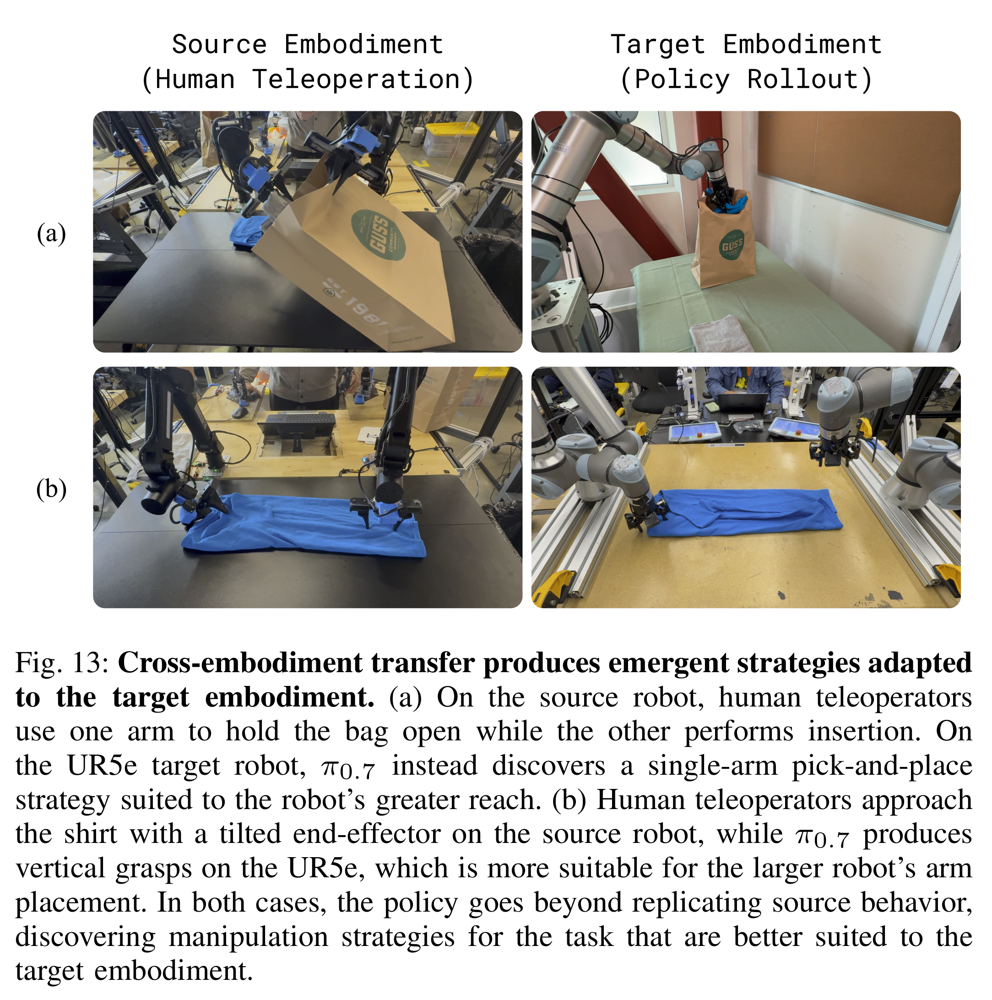
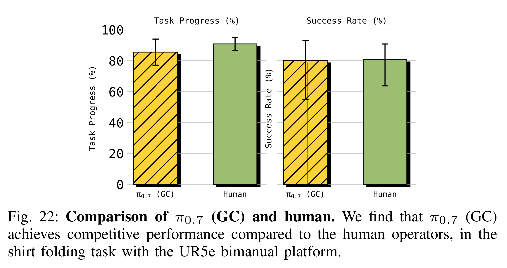

# π0.7: a Steerable Generalist Robotic Foundation Model with Emergent Capabilities

[Official source](https://arxiv.org/abs/2604.15483)

## Abstract—

We present a new robotic foundation model, called π0.7, that can enable strong out-of-the-box performance in a wide range of scenarios.π 0.7 can follow diverse language instruc- tions in unseen environments, including multi-stage tasks with various kitchen appliances, provide zero-shot cross-embodiment generalization, for example enabling a robot to fold laundry without seeing the task before, and perform challenging tasks such as operating an espresso machine out of the box at a level of performance that matches much more specialized RL-finetuned models. The main idea behindπ 0.7 is to use diverse context conditioning during training. This conditioning information, contained in the prompt, makes it possible to steer the model precisely to perform many tasks with different strategies. It is conditioned not just on a language command that describes what it should do, but on additional multimodal information that also describes the manner or strategy in which it should do it, including metadata about task performance and subgoal images. This enablesπ 0.7 to use very diverse data, including demonstrations, potentially suboptimal (autonomous) data including failures, and data from non-robot sources. Our experiments evaluateπ 0.7 across numerous tasks with multiple robot platforms, on tasks that require speed and dexterity, language following, and compositional task generalization.

Fig. 2: Architecture overview. The π0.7 model is a 5B-parameter VLA consisting of a 4B VLM backbone, a MEM-style video history encoder and a 860M
parameter action expert. The model’s context includes multiple distinct modalities, including language commands, episode metadata that describes the data
quality and strategy, and multimodal inputs such as subgoal images. At runtime, the language commands are produced by a high-level semantic policy based
on the same architecture, and the subgoal images are produced by a lightweight world model based on the BAGEL image generation model [105].

p. 4

Fig. 13: Cross-embodiment transfer produces emergent strategies adapted
to the target embodiment. (a) On the source robot, human teleoperators
use one arm to hold the bag open while the other performs insertion. On
the UR5e target robot, π0.7 instead discovers a single-arm pick-and-place
strategy suited to the robot’s greater reach. (b) Human teleoperators approach
the shirt with a tilted end-effector on the source robot, while π0.7 produces
vertical grasps on the UR5e, which is more suitable for the larger robot’s arm
placement. In both cases, the policy goes beyond replicating source behavior,
discovering manipulation strategies for the task that are better suited to the
target embodiment.

p. 12

Fig. 22: Comparison of π0.7 (GC) and human. We find that π0.7 (GC)
achieves competitive performance compared to the human operators, in the
shirt folding task with the UR5e bimanual platform.

p. 23
