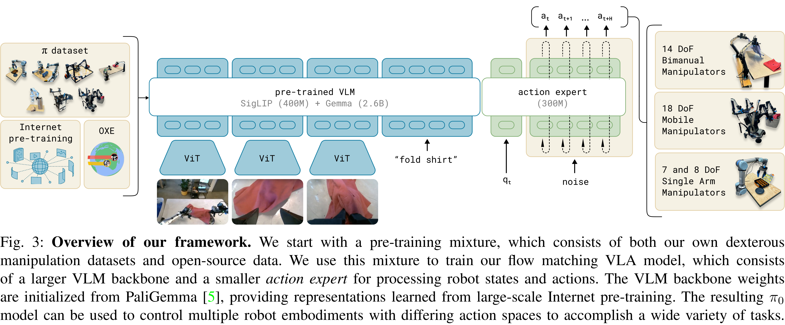
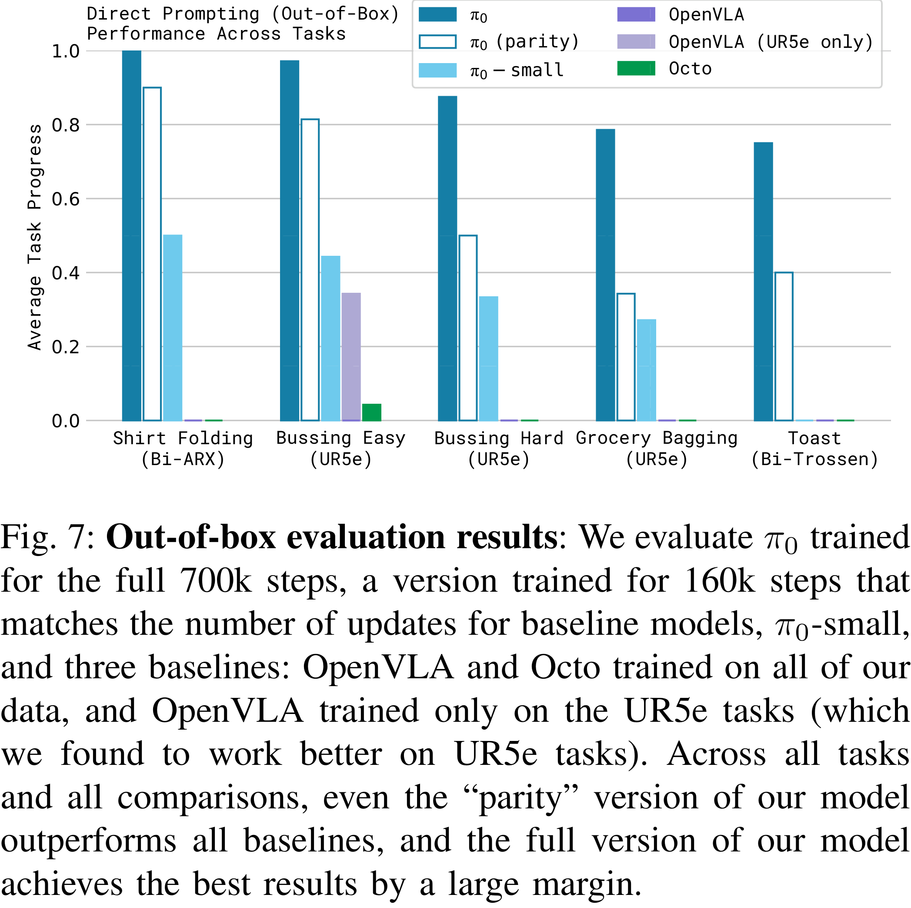

# π0: A Vision-Language-Action Flow Model for General Robot Control

[Official source](https://arxiv.org/abs/2410.24164)

## Abstract—

Robot learning holds tremendous promise to unlock the full potential of flexible, general, and dexterous robot systems, as well as to address some of the deepest questions in artificial intelligence. However, bringing robot learning to the level of generality required for effective real-world systems faces major obstacles in terms of data, generalization, and robustness. In this paper, we discuss how generalist robot policies (i.e., robot foundation models) can address these challenges, and how we can design effective generalist robot policies for complex and highly dexterous tasks. We propose a novel flow matching architecture

built on top of a pre-trained vision-language model (VLM) to inherit Internet-scale semantic knowledge. We then discuss how this model can be trained on a large and diverse dataset from multiple dexterous robot platforms, including single-arm robots, dual-arm robots, and mobile manipulators. We evaluate our model in terms of its ability to perform tasks via direct prompting, follow language instructions from people and from a high-level VLM policy, and its ability to acquire new skills via fine-tuning. Our results cover a wide variety of tasks, such as laundry folding, table cleaning, and assembling boxes.

Fig. 3: Overview of our framework. We start with a pre-training mixture, which consists of both our own dexterous manipulation datasets and open-source data. We use this mixture to train our flow matching VLA model, which consists of a larger VLM backbone and a smaller action expert for processing robot states and actions. The VLM backbone weights are initialized from PaliGemma [5], providing representations learned from large-scale Internet pre-training. The resulting π0 model can be used to control multiple robot embodiments with differing action spaces to accomplish a wide variety of tasks.

p. 4

Fig. 7: Out-of-box evaluation results: We evaluate π0 trained for the full 700k steps, a version trained for 160k steps that matches the number of updates for baseline models, π0-small, and three baselines: OpenVLA and Octo trained on all of our data, and OpenVLA trained only on the UR5e tasks (which we found to work better on UR5e tasks). Across all tasks and all comparisons, even the “parity” version of our model outperforms all baselines, and the full version of our model achieves the best results by a large margin.

p. 8
