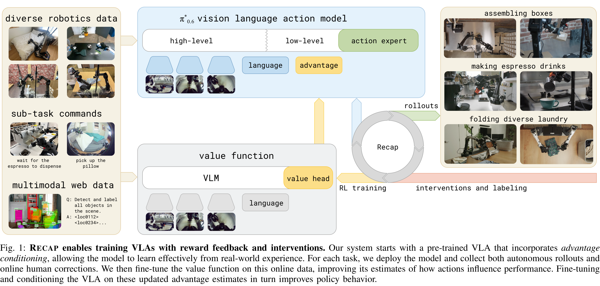
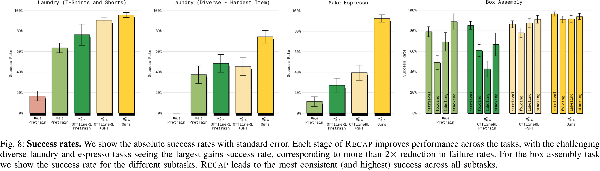

# π*0.6: a VLA That Learns From Experience

[Official source](https://arxiv.org/abs/2511.14759)

## Abstract—

We study how vision-language-action (VLA) models can improve through real-world deployments via reinforcement learning (RL). We present a general-purpose method, RL with Experience and Corrections via Advantage-conditioned Policies (RECAP), that provides for RL training of VLAs via advantage conditioning. Our method incorporates heterogeneous data into the self-improvement process, including demonstrations, data from on-policy collection, and expert teleoperated interventions provided during autonomous execution. RECAP starts by pre- training a generalist VLA with offline RL, which we call π∗ 0.6, that can then be specialized to attain high performance on downstream tasks through on-robot data collection. We show that the π∗ 0.6 model trained with the full RECAP method can fold laundry in real homes, reliably assemble boxes, and make espresso drinks using a professional espresso machine. On some of the hardest tasks, RECAP more than doubles task throughput and roughly halves the task failure rate.

Fig. 1: RECAP enables training VLAs with reward feedback and interventions. Our system starts with a pre-trained VLA that incorporates advantage conditioning, allowing the model to learn effectively from real-world experience. For each task, we deploy the model and collect both autonomous rollouts and online human corrections. We then fine-tune the value function on this online data, improving its estimates of how actions influence performance. Fine-tuning and conditioning the VLA on these updated advantage estimates in turn improves policy behavior.

p. 1

Fig. 8: Success rates. We show the absolute success rates with standard error. Each stage of RECAP improves performance across the tasks, with the challenging diverse laundry and espresso tasks seeing the largest gains success rate, corresponding to more than 2× reduction in failure rates. For the box assembly task we show the success rate for the different subtasks. RECAP leads to the most consistent (and highest) success across all subtasks.

p. 9
