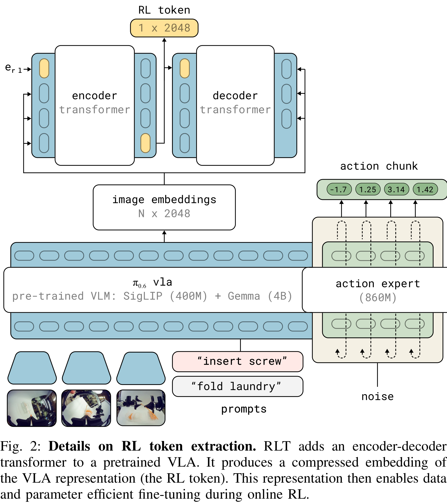
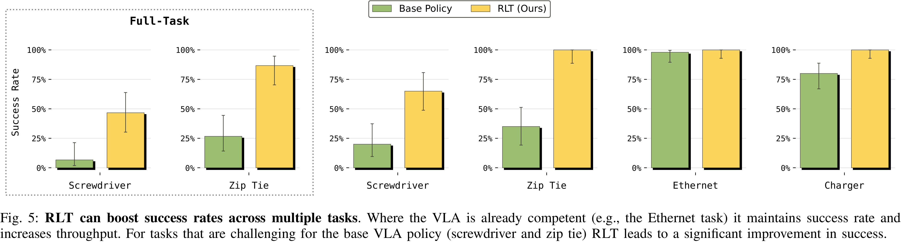

# RL Token: Bootstrapping Online RL with Vision-Language-Action Models

[Official source](https://www.pi.website/research/rlt)

## Abstract—

Vision-language-action (VLA) models can learn to perform diverse manipulation skills “out of the box,” but achiev- ing the precision and speed that real-world tasks demand requires further fine-tuning – for example, via reinforcement learning (RL). We introduce a lightweight method that enables sample- efficient online RL fine-tuning of pretrained VLAs using just a few hours of real-world practice. We (1) adapt the VLA to expose an “RL token,” a compact readout representation that preserves task-relevant pretrained knowledge while serving as an efficient interface for online RL, and (2) train a small actor-critic head on this RL token to refine the actions, while anchoring the learned policy to the VLA. Online RL with the RL token (RLT) makes it possible to fine-tune even large VLAs with RL quickly and efficiently. Across four real-robot tasks (screw installation, zip tie fastening, charger insertion, and Ethernet insertion) RLT improves the speed on the hardest part of the task by up to 3× and raises success rates significantly within minutes to a few hours of practice. It can even surpass the speed of human teleoperation on some of the tasks.

Fig. 2: Details on RL token extraction. RLT adds an encoder-decoder transformer to a pretrained VLA. It produces a compressed embedding of the VLA representation (the RL token). This representation then enables data and parameter efficient fine-tuning during online RL.

p. 4

Fig. 5: RLT can boost success rates across multiple tasks. Where the VLA is already competent (e.g., the Ethernet task) it maintains success rate and increases throughput. For tasks that are challenging for the base VLA policy (screwdriver and zip tie) RLT leads to a significant improvement in success.

p. 8
