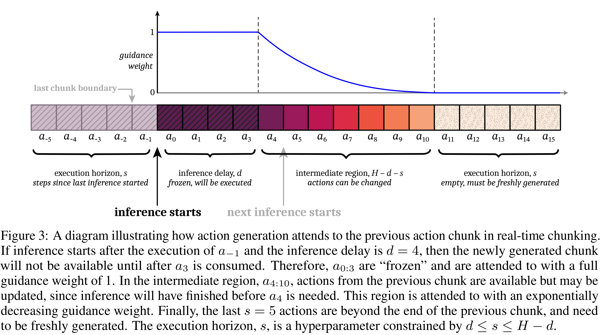
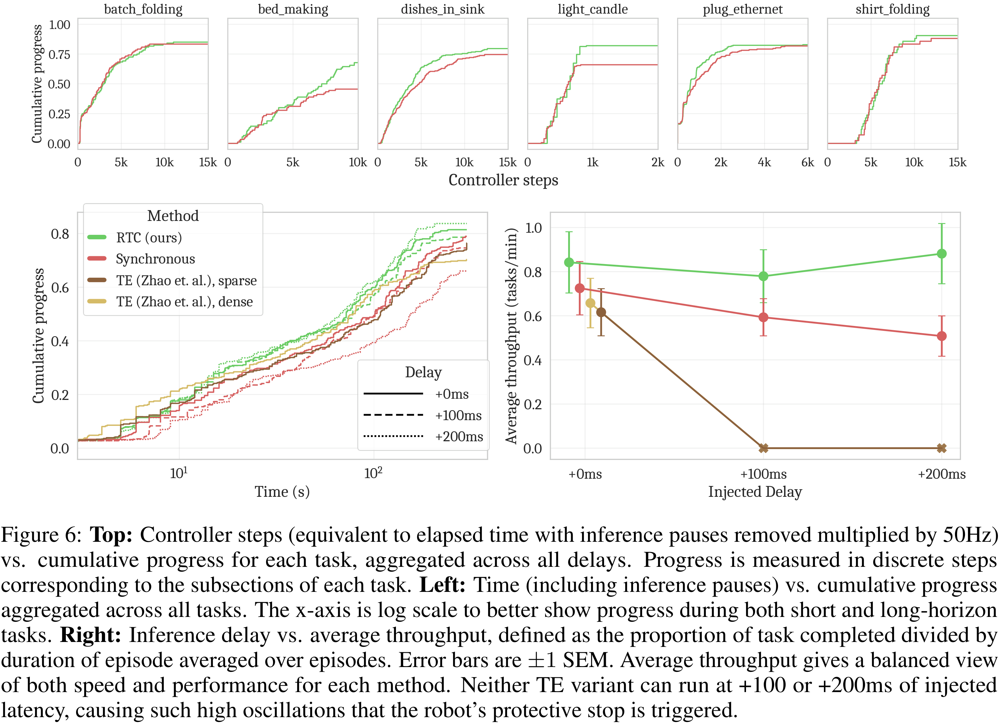

# Real-Time Execution of Action Chunking Flow Policies

[Official source](https://arxiv.org/abs/2506.07339)

## Abstract

Modern AI systems, especially those interacting with the physical world, increasingly require real-time performance. However, the high latency of state-of-the-art generalist models, including recent vision-language-action models (VLAs), poses a significant challenge. While action chunking has enabled temporal consistency in high-frequency control tasks, it does not fully address the latency problem, leading to pauses or out-of-distribution jerky movements at chunk boundaries. This paper presents a novel inference-time algorithm that enables smooth asynchronous execution of action chunking policies. Our method, real-time chunking (RTC), is applicable to any diffusion- or flow-based VLA out of the box with no re-training. It generates the next action chunk while executing the current one, “freezing” actions guaranteed to execute and “inpainting” the rest. To test RTC, we introduce a new benchmark of 12 highly dynamic tasks in the Kinetix simulator, as well as evaluate 6 challenging real-world bimanual manipulation tasks. Results demonstrate that RTC is fast, performant, and uniquely robust to inference delay, significantly improving task throughput and enabling high success rates in precise tasks—such as lighting a match—even in the presence of significant latency. See https://pi.website/research/real_time_chunking for videos.

Figure 3: A diagram illustrating how action generation attends to the previous action chunk in real-time chunking. If inference starts after the execution of a−1 and the inference delay is d = 4, then the newly generated chunk will not be available until after a3 is consumed. Therefore, a0:3 are “frozen” and are attended to with a full guidance weight of 1. In the intermediate region, a4:10, actions from the previous chunk are available but may be updated, since inference will have finished before a4 is needed. This region is attended to with an exponentially decreasing guidance weight. Finally, the last s = 5 actions are beyond the end of the previous chunk, and need to be freshly generated. The execution horizon, s, is a hyperparameter constrained by d ≤s ≤H −d.

p. 4

Figure 6: Top: Controller steps (equivalent to elapsed time with inference pauses removed multiplied by 50Hz) vs. cumulative progress for each task, aggregated across all delays. Progress is measured in discrete steps corresponding to the subsections of each task. Left: Time (including inference pauses) vs. cumulative progress aggregated across all tasks. The x-axis is log scale to better show progress during both short and long-horizon tasks. Right: Inference delay vs. average throughput, defined as the proportion of task completed divided by duration of episode averaged over episodes. Error bars are ±1 SEM. Average throughput gives a balanced view of both speed and performance for each method. Neither TE variant can run at +100 or +200ms of injected latency, causing such high oscillations that the robot’s protective stop is triggered.

p. 8
