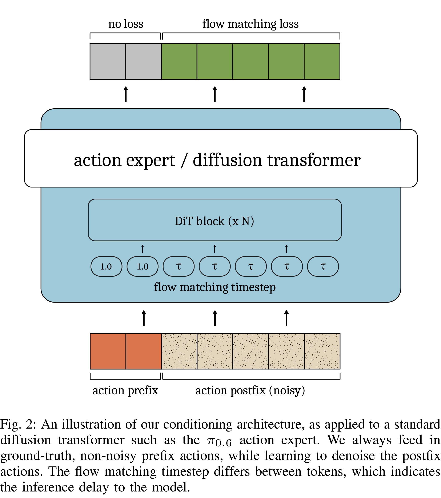
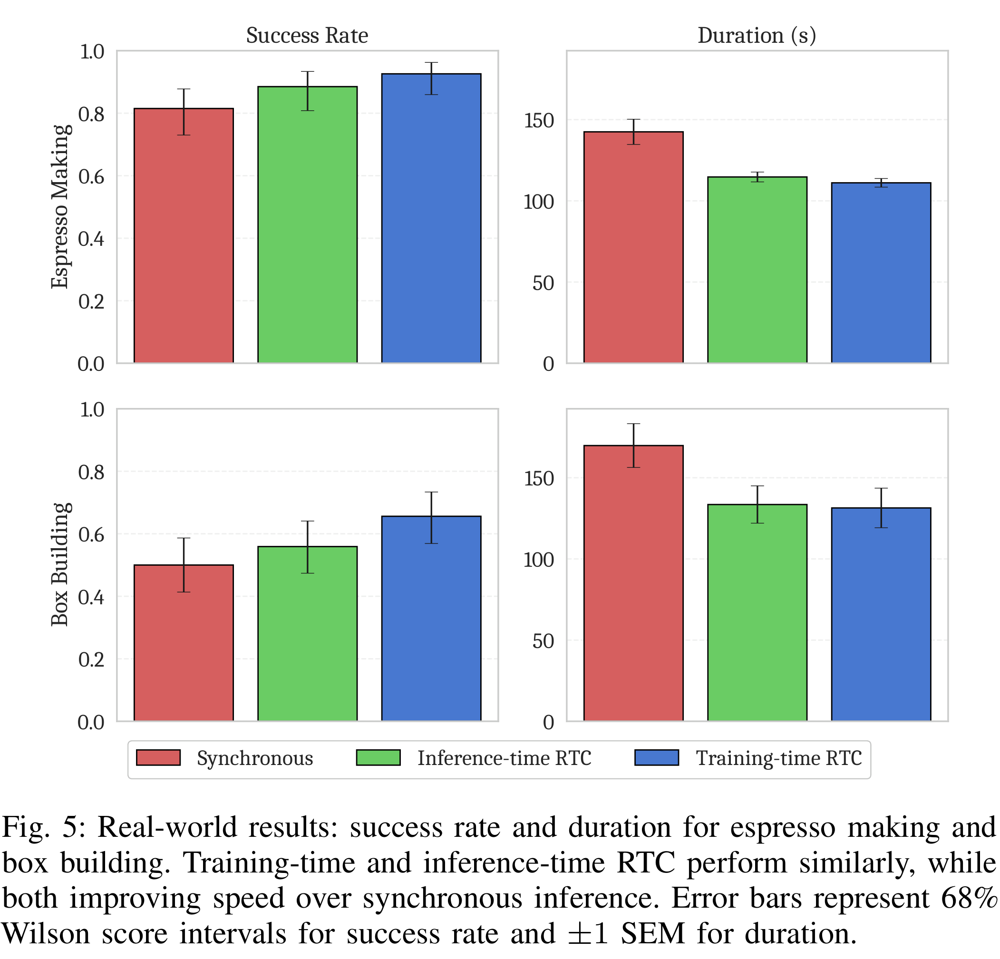

# Training-Time Action Conditioning for Efficient Real-Time Chunking

[Official source](https://arxiv.org/abs/2512.05964)

## Abstract—

Real-time chunking (RTC) enables vision-language-action models (VLAs) to generate smooth, reactive robot trajectories by asynchronously predicting action chunks and conditioning on previously committed actions via inference-time inpainting. However, this inpainting method introduces computational overhead that increases inference latency. In this work, we propose a simple alternative: simulating inference delay at training time and conditioning on action prefixes directly, eliminating any inference-time overhead. Our method requires no modifications to the model architecture or robot runtime, and can be implemented with only a few additional lines of code. In simulated experiments, we find that training-time RTC outperforms inference-time RTC at higher inference delays. In real-world experiments on box building and espresso making tasks with the π0.6 VLA, we demonstrate that training-time RTC maintains both task performance and speed parity with inference-time RTC while being computationally cheaper. Our results suggest that training-time action conditioning is a practical drop-in replacement for inference-time inpainting in real-time robot control.

Fig. 2: An illustration of our conditioning architecture, as applied to a standard diffusion transformer such as the π0.6 action expert. We always feed in ground-truth, non-noisy prefix actions, while learning to denoise the postfix actions. The flow matching timestep differs between tokens, which indicates the inference delay to the model.

p. 2

Fig. 5: Real-world results: success rate and duration for espresso making and box building. Training-time and inference-time RTC perform similarly, while both improving speed over synchronous inference. Error bars represent 68% Wilson score intervals for success rate and ±1 SEM for duration.

p. 3
