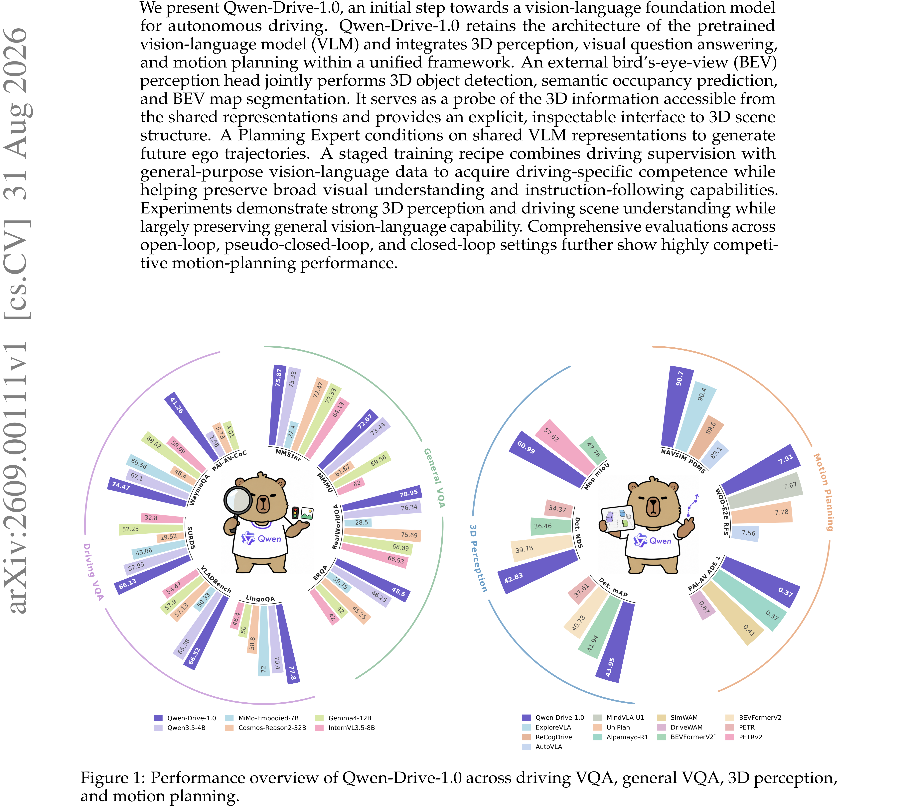
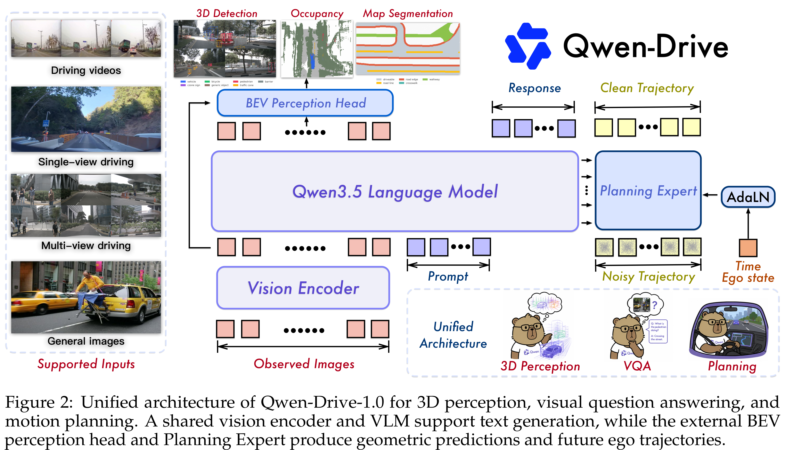

# Qwen-Drive-1.0: An Initial Step towards a Vision-Language Foundation Model for Autonomous Driving

[Official source](https://github.com/QwenLM/Qwen-Drive-1.0)

## Abstract

We present Qwen-Drive-1.0, an initial step towards a vision-language foundation model for autonomous driving. Qwen-Drive-1.0 retains the architecture of the pretrained vision-language model (VLM) and integrates 3D perception, visual question answering, and motion planning within a unified framework. An external bird’s-eye-view (BEV) perception head jointly performs 3D object detection, semantic occupancy prediction, and BEV map segmentation. It serves as a probe of the 3D information accessible from the shared representations and provides an explicit, inspectable interface to 3D scene structure. A Planning Expert conditions on shared VLM representations to generate future ego trajectories. A staged training recipe combines driving supervision with general-purpose vision-language data to acquire driving-specific competence while helping preserve broad visual understanding and instruction-following capabilities. Experiments demonstrate strong 3D perception and driving scene understanding while largely preserving general vision-language capability. Comprehensive evaluations across open-loop, pseudo-closed-loop, and closed-loop settings further show highly competi- tive motion-planning performance.

Figure 1: Performance overview of Qwen-Drive-1.0 across driving VQA, general VQA, 3D perception,
and motion planning.

p. 1

Figure 2: Unified architecture of Qwen-Drive-1.0 for 3D perception, visual question answering, and
motion planning. A shared vision encoder and VLM support text generation, while the external BEV
perception head and Planning Expert produce geometric predictions and future ego trajectories.

p. 3
