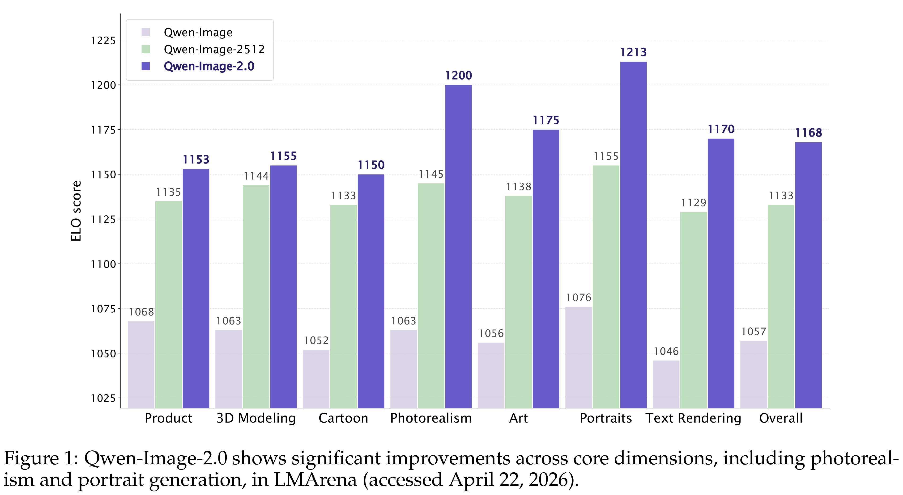
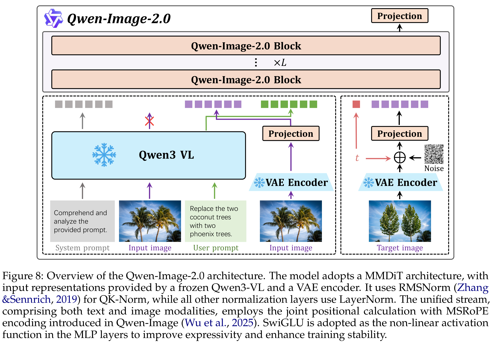

# Qwen-Image-2.0 Technical Report

[Official source](https://arxiv.org/abs/2605.10730)

## Abstract

We present Qwen-Image-2.0, an omni-capable image generation foundation model that unifies high-fidelity image generation and precise image editing within a single integrated framework. While current image generation foundation models excel at high-quality aesthetic generation and text rendering, they still face significant challenges in practical creative workflows, including ultra-long text rendering, complex multilingual typography, high-resolution photorealism, robust instruction following, and efficient deployment. These limitations are particularly pronounced in text-rich and compositionally complex scenarios, where visual fidelity must be jointly maintained with semantic accuracy, typographic correctness, and layout coherence. More fundamentally, few existing systems can deliver all these capabilities for both image generation and image editing simultaneously within a single unified model without pipeline switching. To address these challenges, Qwen-Image-2.0 couples Qwen3-VL as the condition encoder with a Multimodal Diffusion Transformer for joint condition-target modeling, supported by comprehensive data curation and a customized multi-stage training pipeline. This design enables the model to leverage strong multimodal understanding while preserving the generative flexibility required for diverse creation and editing tasks. Specifically, Qwen-Image-2.0 enables ultra-long text rendering with instructions of up to 1K tokens, allowing direct generation of professional text-rich visual content such as slides, posters, infographics, and comics. It also substantially improves multilingual text rendering across diverse languages, with higher character fidelity and support for more complex and visually appealing typography. Beyond text-centric scenarios, the model advances high-resolution photorealistic image generation, producing richer local details, more realistic textures and materials, and more coherent lighting and shading. In addition, Qwen-Image-2.0 yields more stable quality across diverse artistic styles and follows complex prompts more faithfully, reducing concept omission, compositional failure, and hallucinated content. Extensive human evaluations show that Qwen-Image-2.0 delivers substantial improvements over previous Qwen-Image series models in both image generation and editing, demonstrating clear advances in overall visual quality, editing capability, and practical usability. We believe Qwen-Image-2.0 marks a meaningful step toward more general, reliable, and practical image generation foundation models, laying the groundwork for a unified generative backbone across contemporary visual creation, editing, and multimodal downstream applications.

Figure 1: Qwen-Image-2.0 shows significant improvements across core dimensions, including photorealism and portrait generation, in LMArena (accessed April 22, 2026).

p. 1

Figure 8: Overview of the Qwen-Image-2.0 architecture. The model adopts a MMDiT architecture, with input representations provided by a frozen Qwen3-VL and a VAE encoder. It uses RMSNorm (Zhang &Sennrich, 2019) for QK-Norm, while all other normalization layers use LayerNorm. The unified stream, comprising both text and image modalities, employs the joint positional calculation with MSRoPE encoding introduced in Qwen-Image (Wu et al., 2025). SwiGLU is adopted as the non-linear activation function in the MLP layers to improve expressivity and enhance training stability.

p. 10
