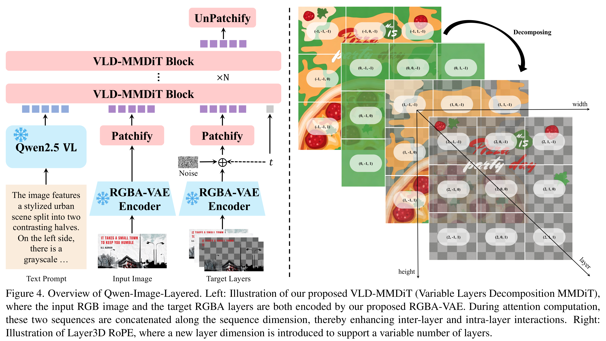
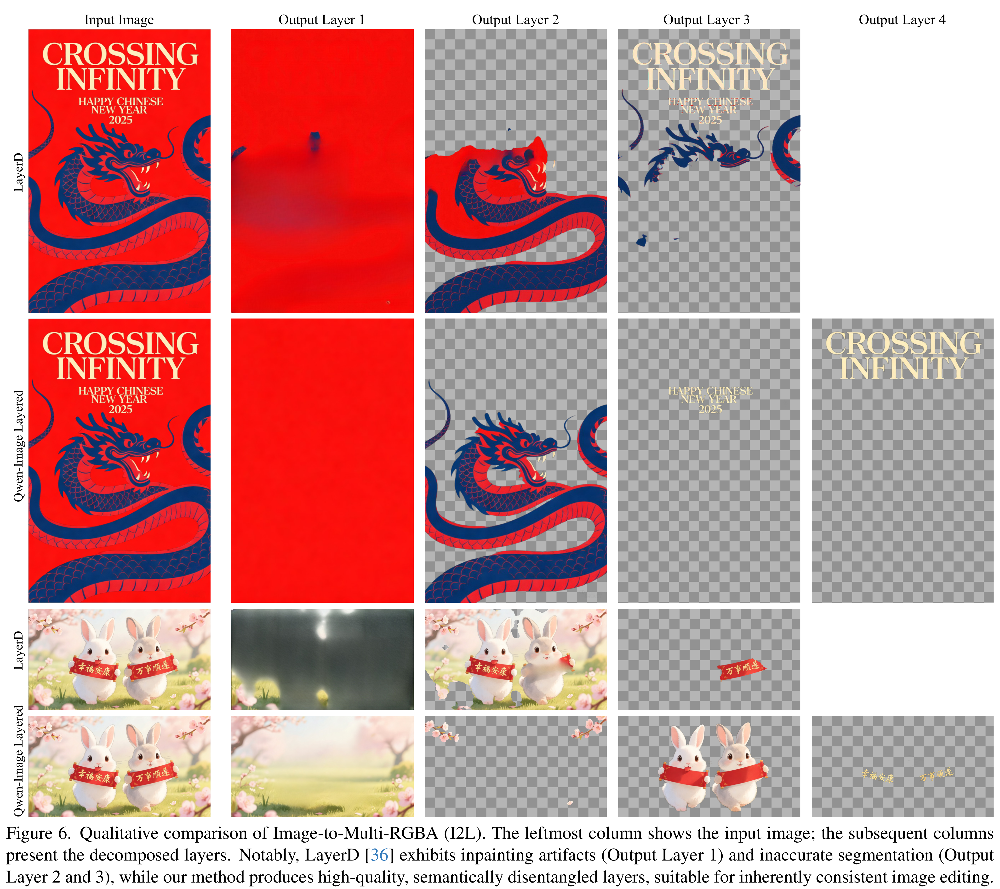

# Qwen-Image-Layered: Towards Inherent Editability via Layer Decomposition

[Official source](https://github.com/QwenLM/Qwen-Image-Layered)

## Abstract

Recent visual generative models often struggle with consistency during image editing due to the entangled nature of raster images, where all visual content is fused into a single canvas. In contrast, professional design tools employ layered representations, allowing isolated edits while preserving consistency. Motivated by this, we propose Qwen-Image-Layered, an end-to-end diffusion model that decomposes a single RGB image into multiple semantically disentangled RGBA layers, enabling inherent editability, where each RGBA layer can be independently manipulated without affecting other content. To support variable-length decomposition, we introduce three key components: (1) an RGBA-VAE to unify the latent representations of RGB and RGBA images; (2) a VLD-MMDiT (Variable Layers Decomposition MMDiT) architecture capable of decomposing a variable number of image layers; and (3) a Multi-stage Training strategy to adapt a pretrained image generation model into a multilayer image decomposer. Furthermore, to address the scarcity of high-quality multilayer training images, we build a pipeline to extract and annotate multilayer images from Photoshop documents (PSD). Experiments demonstrate that our method significantly surpasses existing approaches in decomposition quality and establishes a new paradigm for consistent image editing. Our code and models are released on https://github.com/QwenLM/Qwen-Image-Layered

Figure 4. Overview of Qwen-Image-Layered. Left: Illustration of our proposed VLD-MMDiT (Variable Layers Decomposition MMDiT), where the input RGB image and the target RGBA layers are both encoded by our proposed RGBA-VAE. During attention computation, these two sequences are concatenated along the sequence dimension, thereby enhancing inter-layer and intra-layer interactions. Right: Illustration of Layer3D RoPE, where a new layer dimension is introduced to support a variable number of layers.

p. 6

Figure 6. Qualitative comparison of Image-to-Multi-RGBA (I2L). The leftmost column shows the input image; the subsequent columns present the decomposed layers. Notably, LayerD [36] exhibits inpainting artifacts (Output Layer 1) and inaccurate segmentation (Output Layer 2 and 3), while our method produces high-quality, semantically disentangled layers, suitable for inherently consistent image editing.

p. 8
