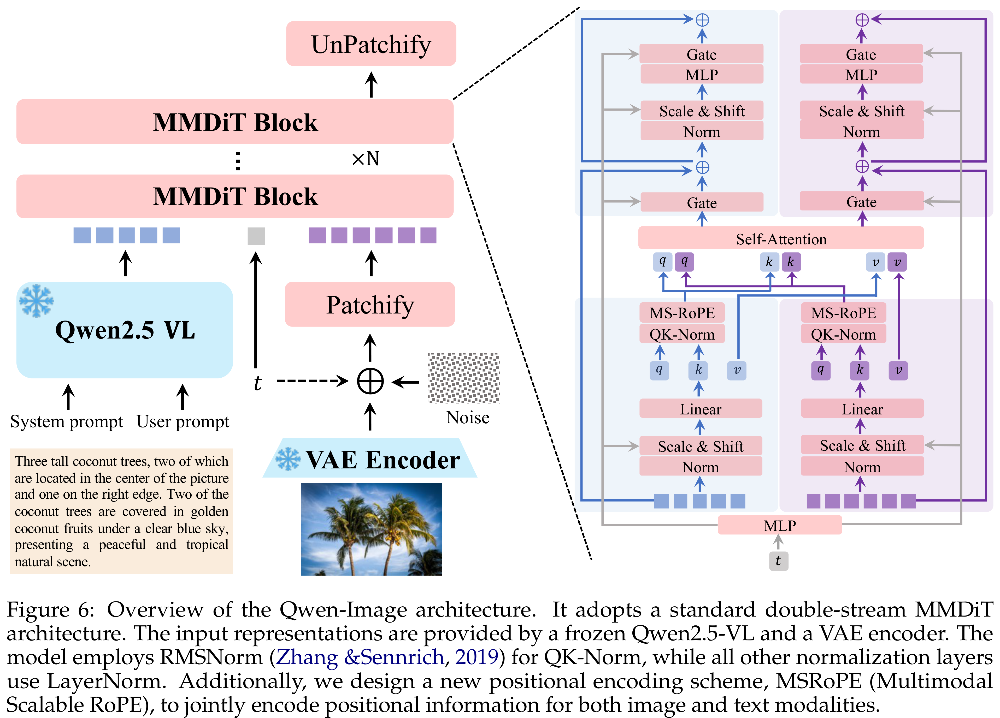
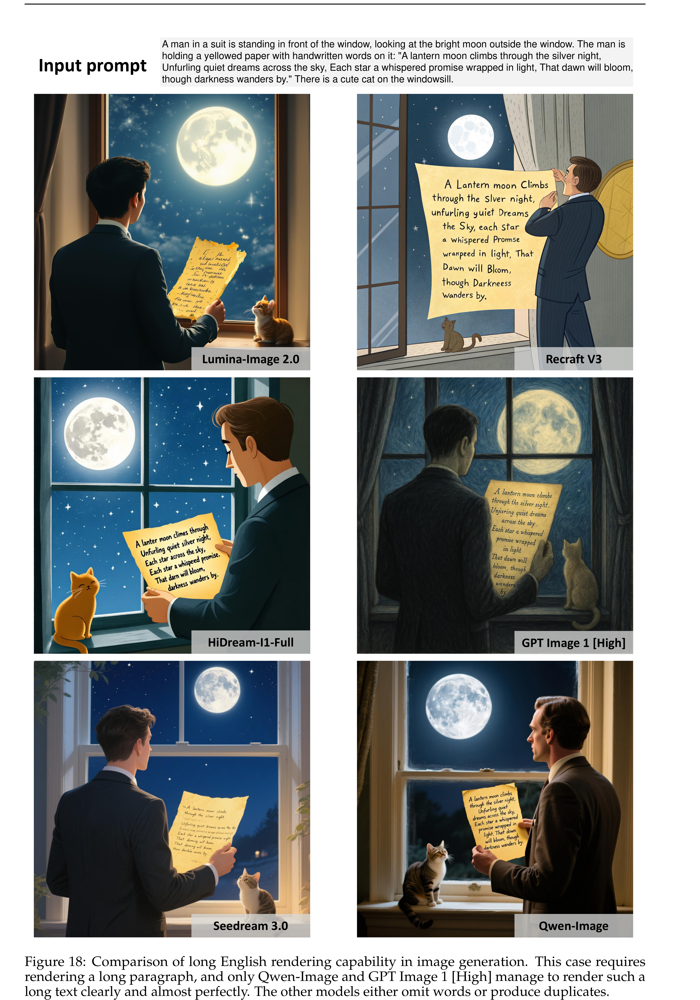

# Qwen-Image Technical Report

[Official source](https://github.com/QwenLM/Qwen-Image)

## Abstract

We present Qwen-Image, an image generation foundation model in the Qwen series that achieves significant advances in complex text rendering and precise image editing. To address the challenges of complex text rendering, we design a comprehensive data pipeline that includes large-scale data collection, filtering, annotation, synthesis, and balancing. Moreover, we adopt a progressive training strategy that starts with non-text-to-text rendering, evolves from simple to complex textual inputs, and gradually scales up to paragraph-level descriptions. This curriculum learning approach substantially enhances the model’s native text rendering capabilities. As a result, Qwen-Image not only performs exceptionally well in alphabetic languages such as English, but also achieves remarkable progress on more challenging logographic languages like Chinese. To enhance image editing consistency, we introduce an improved multi-task training paradigm that incorporates not only traditional text-to-image (T2I) and text-image-to-image (TI2I) tasks but also image-to-image (I2I) reconstruction, effectively aligning the latent representations between Qwen2.5-VL and MMDiT. Furthermore, we separately feed the original image into Qwen2.5-VL and the VAE encoder to obtain semantic and reconstructive representations, respectively. This dual-encoding mechanism enables the editing module to strike a balance between preserving semantic consistency and maintaining visual fidelity. We present a comprehensive evaluation of Qwen-Image across multiple public benchmarks, including GenEval, DPG, and OneIG-Bench for general image generation, as well as GEdit, ImgEdit, and GSO for image editing. Qwen-Image achieves state-of-the-art performance, demonstrating its strong capabilities in both image generation and editing. Furthermore, results on LongText-Bench, ChineseWord, and CVTG-2K show that it excels in text rendering—particularly in Chinese text generation—outperforming existing state-of-the-art models by a significant margin. This highlights Qwen-Image’s unique position as a leading image generation model that combines broad general capability with exceptional text rendering precision.

Figure 6: Overview of the Qwen-Image architecture. It adopts a standard double-stream MMDiT architecture. The input representations are provided by a frozen Qwen2.5-VL and a VAE encoder. The model employs RMSNorm (Zhang &Sennrich, 2019) for QK-Norm, while all other normalization layers use LayerNorm. Additionally, we design a new positional encoding scheme, MSRoPE (Multimodal Scalable RoPE), to jointly encode positional information for both image and text modalities.

p. 7

Figure 18: Comparison of long English rendering capability in image generation. This case requires rendering a long paragraph, and only Qwen-Image and GPT Image 1 [High] manage to render such a long text clearly and almost perfectly. The other models either omit words or produce duplicates.

p. 28
