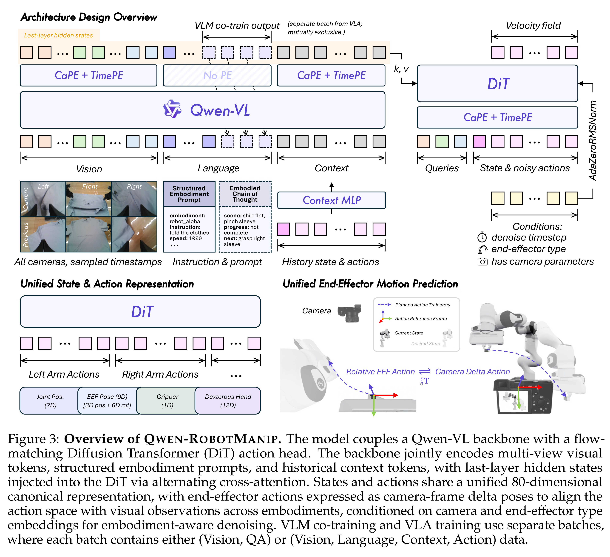
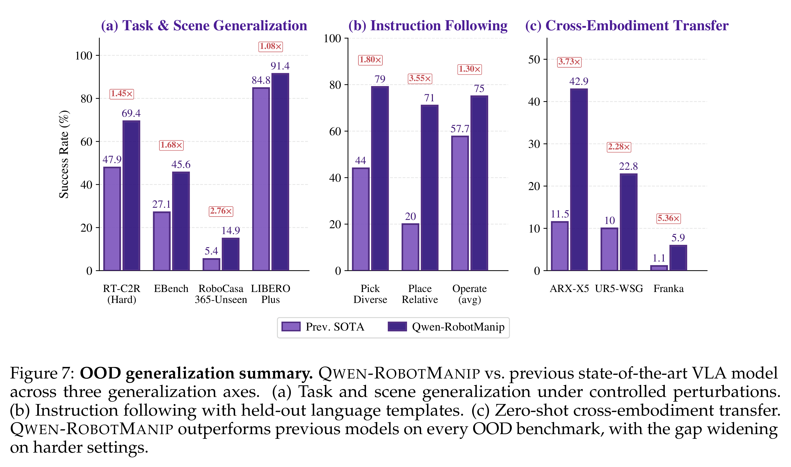

# Qwen-RobotManip Technical Report: Alignment Unlocks Scale for Robotic Manipulation Foundation Models

[Official source](https://github.com/QwenLM/Qwen-RobotManip)

## Abstract

Foundation models in language and multimodality achieve strong generalization because heterogeneous data sources can be aligned under a unified formulation, and abundant low-cost data from the internet allows diverse training signals to reinforce one another at scale. In this report, we investigate whether this scaling recipe can be applied to robotic manipulation to achieve genuine generalization. This is challenging because, unlike text, manipulation data is heterogeneous by nature, expensive to collect, and narrow in diversity, making alignment and scale simultaneously difficult to achieve. We present QWEN-ROBOTMANIP, a generalizable Vision-Language-Action foundation model built upon Qwen-VL. QWEN-ROBOTMANIP introduces a unified alignment framework across the representation, motion, and behavioral dimensions of manipulation, making large-scale multi-source training coherent rather than conflicting. This alignment capability in turn enables QWEN-ROBOTMANIP to absorb manipulation data at a scale that prior training regimes could not sustain. To provide a scaling engine for manipulation data, a human-to-robot synthesis pipeline converts egocentric hand demonstrations into robot trajectories across 15 platforms, and a rigorous curation pipeline harmonizes heterogeneous real-robot and synthetic datasets. To our surprise, by leveraging only open-source robotic manipulation datasets and human demonstration videos without any proprietary data collection, QWEN-ROBOTMANIP constructs a ∼38,100-hour pretraining corpus and already exhibits emergent generalization capabilities, including zero-shot instruction following, robustness to perturbations, reactive error recovery, and cross-embodiment knowledge transfer. In experiments, we further find that most standard benchmarks systematically fail to capture the quality of pretraining. Thus, we instead adopt OOD evaluation settings, including RoboCasa365, LIBERO-Plus, EBench, RoboTwin-Clean2Rand, RoboTwin-IF (our new instruction-following benchmark), and RoboTwin-XE (our new cross-embodiment transfer benchmark), as our north star for measuring genuine generalization. QWEN-ROBOTMANIP achieves substantially better performance than prior state-of-the-art models, including π0.5, across all OOD settings, ranks 1st in RoboChallenge with a 20% relative improvement, and is validated on real-robot platforms including AgileX ALOHA, Franka, UR, and ARX.

Figure 3: Overview of QWEN-ROBOTMANIP. The model couples a Qwen-VL backbone with a flow-matching Diffusion Transformer (DiT) action head. The backbone jointly encodes multi-view visual tokens, structured embodiment prompts, and historical context tokens, with last-layer hidden states injected into the DiT via alternating cross-attention. States and actions share a unified 80-dimensional canonical representation, with end-effector actions expressed as camera-frame delta poses to align the action space with visual observations across embodiments, conditioned on camera and end-effector type embeddings for embodiment-aware denoising. VLM co-training and VLA training use separate batches, where each batch contains either (Vision, QA) or (Vision, Language, Context, Action) data.

p. 11

Figure 7: OOD generalization summary. QWEN-ROBOTMANIP vs. previous state-of-the-art VLA model across three generalization axes. (a) Task and scene generalization under controlled perturbations. (b) Instruction following with held-out language templates. (c) Zero-shot cross-embodiment transfer. QWEN-ROBOTMANIP outperforms previous models on every OOD benchmark, with the gap widening on harder settings.

p. 20
