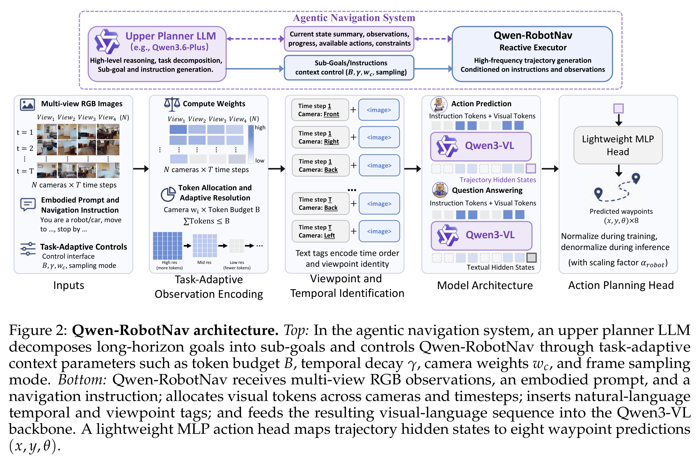
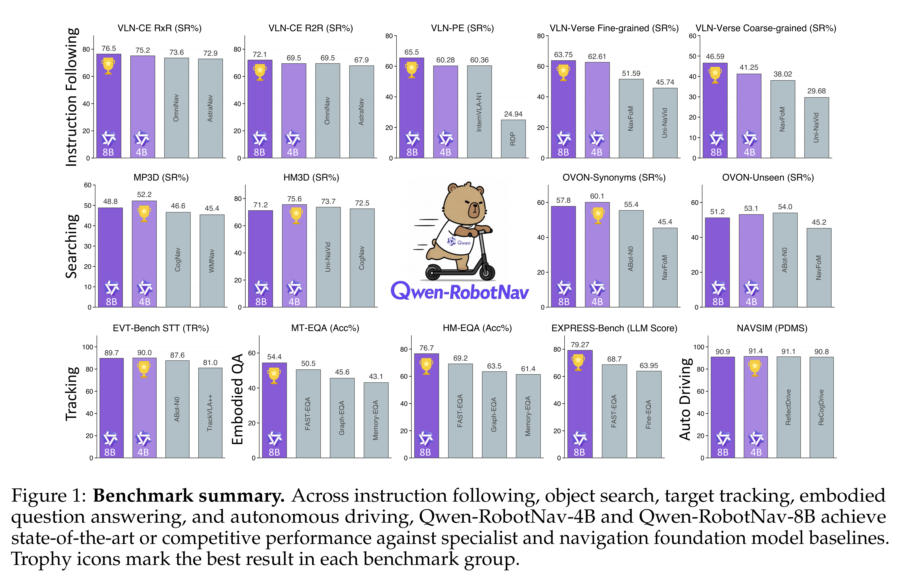

# Qwen-RobotNav Technical Report: A Scalable Navigation Model Designed for an Agentic Navigation System

[Official source](https://github.com/QwenLM/Qwen-RobotNav)

## Abstract

Agentic navigation systems require a base navigation model whose observation strategy can be externally reconfigured at inference time, because instruction following, object search, target tracking, and autonomous driving share the same perception-planning backbone yet demand fundamentally different strategies for consuming the visual stream. We present Qwen-RobotNav, a scalable navigation model built on Qwen3-VL that addresses it through a parameterised interface with two complementary dimensions: multiple task modes that select the navigation behaviour, and controllable observation parameters (e.g., token budget, per-camera weights) that govern how visual history is encoded. With training-time randomization over all parameters, Qwen-RobotNav is robust to any inference-time configuration requiring zero architectural modification to the Qwen3-VL backbone. We train Qwen-RobotNav on 15.6M samples; co-training with vision-language data prevents the collapse into reactive action-sequence mappers observed in trajectory-only training. The parameterised interface also makes Qwen-RobotNav a natural building block for agentic systems: for long-horizon scenarios, an upper-level planner decomposes goals into sub-tasks and dynamically switches Qwen-RobotNav’s task mode and context strategy mid-episode, composing complex behaviours from repeated calls to the same model. Extensive experiments show that Qwen-RobotNav sets new state-of-the-art results across major navigation benchmarks, achieving 76.5% success rate on VLN-CE RxR, 90.0% tracking rate on EVT-Bench, and 91.4 PDMS on NAVSIM. Beyond these standalone results, an agentic navigation system built with Qwen-RobotNav set a new state of the art on Embodied Question Answering, improving over the best prior method by 10.8% on HM-EQA and 15.4% on EXPRESS-Bench while requiring 77% fewer navigation steps. The model exhibits favourable scaling from 2B to 8B parameters, with joint multi-task training developing a shared spatial-planning substrate that transfers across task families, and demonstrates strong zero-shot generalisation to real-world robots across diverse environments.

Figure 2: Qwen-RobotNav architecture. Top: In the agentic navigation system, an upper planner LLM decomposes long-horizon goals into sub-goals and controls Qwen-RobotNav through task-adaptive context parameters such as token budget B, temporal decay γ, camera weights wc, and frame sampling mode. Bottom: Qwen-RobotNav receives multi-view RGB observations, an embodied prompt, and a navigation instruction; allocates visual tokens across cameras and timesteps; inserts natural-language temporal and viewpoint tags; and feeds the resulting visual-language sequence into the Qwen3-VL backbone. A lightweight MLP action head maps trajectory hidden states to eight waypoint predictions (x, y, θ).

p. 4

Figure 1: Benchmark summary. Across instruction following, object search, target tracking, embodied question answering, and autonomous driving, Qwen-RobotNav-4B and Qwen-RobotNav-8B achieve state-of-the-art or competitive performance against specialist and navigation foundation model baselines. Trophy icons mark the best result in each benchmark group.

p. 2
