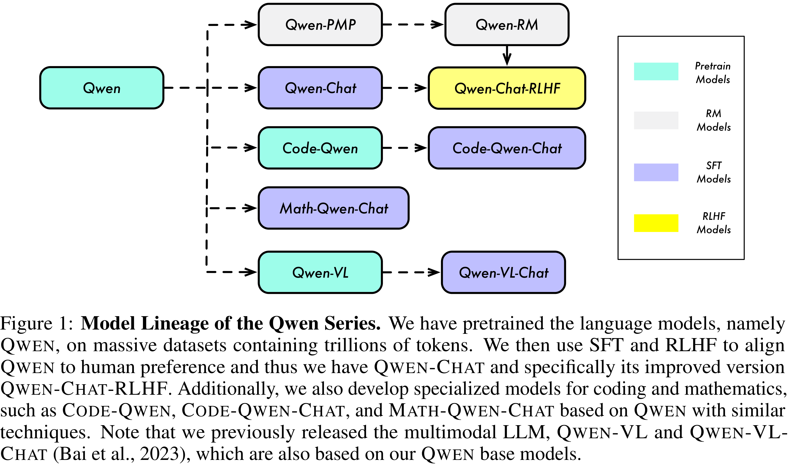

# Qwen Technical Report

[Official source](https://github.com/QwenLM/Qwen)

## ABSTRACT

Large language models (LLMs) have revolutionized the field of artificial intelligence, enabling natural language processing tasks that were previously thought to be exclusive to humans. In this work, we introduce QWEN1, the first installment of our large language model series. QWEN is a comprehensive language model series that encompasses distinct models with varying parameter counts. It includes QWEN, the base pretrained language models, and QWEN-CHAT, the chat models finetuned with human alignment techniques. The base language models consistently demonstrate superior performance across a multitude of downstream tasks, and the chat models, particularly those trained using Reinforcement Learning from Human Feedback (RLHF), are highly competitive. The chat models possess advanced tool-use and planning capabilities for creating agent applications, showcasing impressive performance even when compared to bigger models on complex tasks like utilizing a code interpreter. Furthermore, we have developed coding-specialized models, CODE-QWEN and CODE-QWEN-CHAT, as well as mathematics-focused models, MATH-QWEN-CHAT, which are built upon base language models. These models demonstrate significantly improved performance in comparison with open-source models, and slightly fall behind the proprietary models.

Figure 1: Model Lineage of the Qwen Series. We have pretrained the language models, namely QWEN, on massive datasets containing trillions of tokens. We then use SFT and RLHF to align QWEN to human preference and thus we have QWEN-CHAT and specifically its improved version QWEN-CHAT-RLHF. Additionally, we also develop specialized models for coding and mathematics, such as CODE-QWEN, CODE-QWEN-CHAT, and MATH-QWEN-CHAT based on QWEN with similar techniques. Note that we previously released the multimodal LLM, QWEN-VL and QWEN-VL-CHAT (Bai et al., 2023), which are also based on our QWEN base models.

p. 3
