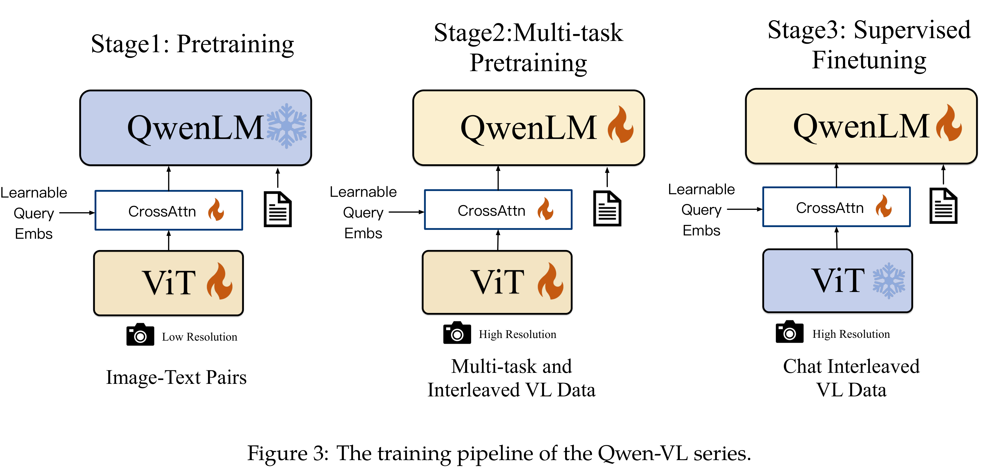

# Qwen-VL: A Versatile Vision-Language Model for Understanding, Localization, Text Reading, and Beyond

[Official source](https://github.com/QwenLM/Qwen3-VL)

## Abstract

In this work, we introduce the Qwen-VL series, a set of large-scale vision-language models (LVLMs) designed to perceive and understand both texts and images. Starting from the Qwen-LM as a foundation, we endow it with visual capacity by the meticulously designed (i) visual receptor, (ii) input-output interface, (iii) 3-stage training pipeline, and (iv) multilingual multimodal cleaned corpus. Beyond the conventional image description and question-answering, we implement the grounding and text-reading ability of Qwen-VLs by aligning image-caption-box tuples. The resulting models, including Qwen-VL and Qwen-VL-Chat, set new records for generalist models under similar model scales on a broad range of visual-centric benchmarks (e.g., image captioning, question answering, visual grounding) and different settings (e.g., zero-shot, few-shot). Moreover, on real-world dialog benchmarks, our instruction-tuned Qwen-VL-Chat also demonstrates superiority compared to existing vision-language chatbots. All models are public to facilitate future research.

Figure 3: The training pipeline of the Qwen-VL series.

p. 4
