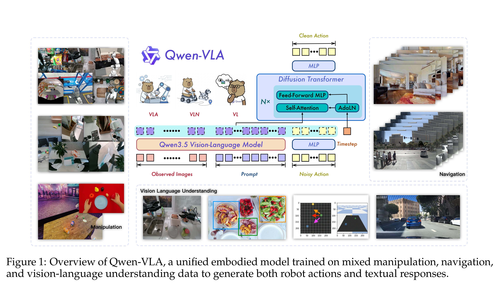
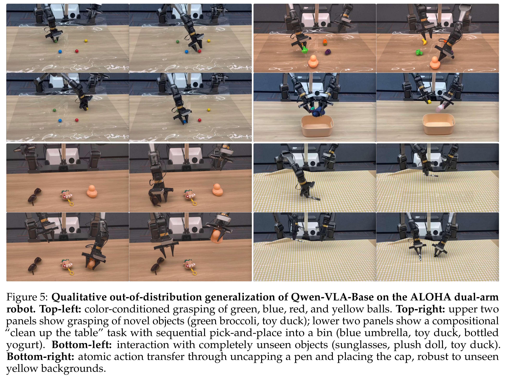

# Qwen-VLA: Unifying Vision-Language-Action Modeling across Tasks, Environments, and Robot Embodiments

[Official source](https://github.com/QwenLM/Qwen-VLA)

## Abstract

Embodied intelligence is often studied through specialized models, each designed for a single scenario or task, such as manipulation and navigation, leading to fragmented capabilities and limited generalization across diverse tasks, environments, and robot embodiments. In this work, we investigate whether these heterogeneous embodied decision-making problems can be unified within a single vision-language-action model. We present Qwen-VLA, a unified embodied foundation model that extends Qwen’s vision-language modeling stack from perception, understanding and reasoning to contin- uous action and trajectory generation through a DiT-based action decoder. Our approach adopts a large-scale joint pretraining recipe over diverse data sources, including robotics manipulation trajectories, human egocentric demonstrations, synthetic simulation data, vision-and-language navigation data, trajectory-centric supervision, and auxiliary vision- language data. To support multiple robot platforms within a shared model, we introduce embodiment-aware prompt conditioning, where robot-specific textual descriptions are prepended to specify the current embodiment and control convention. We further cast manipulation, navigation, and trajectory prediction into a unified action-and-trajectory prediction framework, enabling transferable visual grounding, spatial reasoning, and continuous action generation across robot morphologies, task families, and environments. Experiments on manipulation, navigation, and trajectory-centric benchmarks show that Qwen-VLA supports embodied control across task families and robot embodiments, with consistent multi-task performance and out-of-distribution generalization across varia- tions in scene layout, background, lighting, object configuration, and robot embodiment. As a unified generalist policy, Qwen-VLA-Instruct simultaneously achieves 97.9% on LIBERO, 73.7% on Simpler-WidowX, 86.1/87.2% on RoboTwin-Easy/Hard, 69.0% OSR on R2R, and 59.6% SR on RxR, while further attaining 76.9% average OOD success in real-world ALOHA experiments and 26.6% zero-shot success rate on DOMINO dynamic manipulation.

Figure 1: Overview of Qwen-VLA, a unified embodied model trained on mixed manipulation, navigation, and vision-language understanding data to generate both robot actions and textual responses.

p. 1

Figure 5: Qualitative out-of-distribution generalization of Qwen-VLA-Base on the ALOHA dual-arm robot. Top-left: color-conditioned grasping of green, blue, red, and yellow balls. Top-right: upper two panels show grasping of novel objects (green broccoli, toy duck); lower two panels show a compositional “clean up the table” task with sequential pick-and-place into a bin (blue umbrella, toy duck, bottled yogurt). Bottom-left: interaction with completely unseen objects (sunglasses, plush doll, toy duck). Bottom-right: atomic action transfer through uncapping a pen and placing the cap, robust to unseen yellow backgrounds.

p. 21
