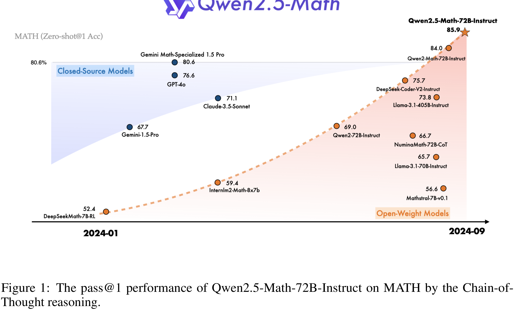

# Qwen2.5-Math Technical Report: Toward Mathematical Expert Model via Self-Improvement

[Official source](https://arxiv.org/abs/2409.12122)

## ABSTRACT

In this report, we present a series of math-specific large language models: Qwen2.5-Math and Qwen2.5-Math-Instruct-1.5B/7B/72B. The core innovation of the Qwen2.5 series lies in integrating the philosophy of self-improvement throughout the entire pipeline, from pre-training and post-training to inference: (1) During the pre-training phase, Qwen2-Math-Instruct is utilized to generate large-scale, high-quality mathematical data. (2) In the post-training phase, we develop a reward model (RM) by conducting massive sampling from Qwen2-Math-Instruct. This RM is then applied to the iterative evolution of data in supervised fine-tuning (SFT). With a stronger SFT model, it’s possible to iteratively train and update the RM, which in turn guides the next round of SFT data iteration. On the final SFT model, we employ the ultimate RM for reinforcement learning, resulting in the Qwen2.5-Math-Instruct. (3) Furthermore, during the inference stage, the RM is used to guide sampling, optimizing the model’s performance. Qwen2.5-Math-Instruct supports both Chinese and English, and possess advanced mathematical reasoning capabilities, including Chain-of-Thought (CoT) and Tool-Integrated Reasoning (TIR). We evaluate our models on 10 mathematics datasets in both English and Chinese, such as GSM8K, MATH, GaoKao, AMC23, and AIME24, covering a range of difficulties from grade school level to math competition problems. The flagship model, Qwen2.5-Math-72B-Instruct, significantly outperforms both open-source models and leading closed-source models (e.g., GPT-4o, Gemini Math-Specialized 1.5 Pro). Particularly in the challenging AMC 2023, with the assistance of RM, Qwen2.5-Math-72B-Instruct successfully solves almost all the problems. Qwen2.5-Math-7B-Instruct surpasses Qwen2-Math-Instruct 72B in performance. Under CoT and TIR settings, it achieves MATH scores of 83.6 and 85.3, respectively. Even our smallest 1.5B model, achieving a MATH score of around 80 when utilizing the Python Interpreter, outperforms the majority of current models in this domain. We hope that Qwen2.5-Math can contribute to the community for solving complex mathematical problems. The base models, instruct models, and reward model of the Qwen2.5-Math series are available on Hugging Face 1 and ModelScope2, and the evaluation scripts on GitHub3. We have also developed a demo that supports the TIR mode in Qwen-Agent4, which allows running code locally to experience Tool-Integrated Reasoning capabilities of Qwen2.5-Math.

Figure 1: The pass@1 performance of Qwen2.5-Math-72B-Instruct on MATH by the Chain-of-Thought reasoning.

p. 3
