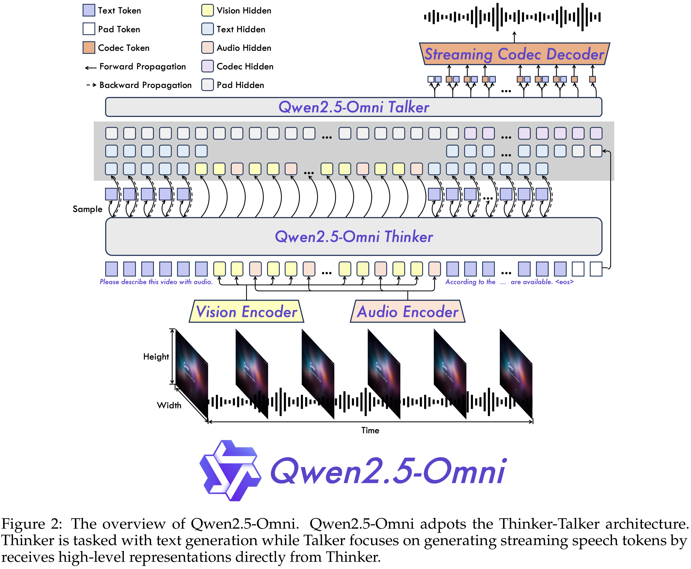

# Qwen2.5-Omni Technical Report

[Official source](https://github.com/QwenLM/Qwen2.5-Omni)

## Abstract

In this report, we present Qwen2.5-Omni, an end-to-end multimodal model designed to perceive diverse modalities, including text, images, audio, and video, while simultaneously generating text and natural speech responses in a streaming manner. To enable the streaming of multimodal information inputs, both audio and visual encoders utilize a block-wise processing approach. This strategy effectively decouples the handling of long sequences of multimodal data, assigning the perceptual responsibilities to the multimodal encoder and entrusting the modeling of extended sequences to a large language model. Such a division of labor enhances the fusion of different modalities via the shared attention mechanism. To synchronize the timestamps of video inputs with audio, we organize the audio and video sequentially in an interleaved manner and propose a novel position embedding approach, named TMRoPE (Time-aligned Multimodal RoPE). To concurrently generate text and speech while avoiding interference between the two modalities, we propose Thinker-Talker architecture. In this framework, Thinker functions as a large language model tasked with text generation, while Talker is a dual-track autoregressive model that directly utilizes the hidden representations from the Thinker to produce audio tokens as output. Both the Thinker and Talker models are designed to be trained and inferred in an end-to-end manner. For decoding audio tokens in a streaming manner, we introduce a sliding-window DiT that restricts the receptive field, aiming to reduce the initial package delay. Qwen2.5-Omni is comparable with similarly sized Qwen2.5-VL and outperforms Qwen2-Audio. Furthermore, Qwen2.5-Omni achieves state-of-the-art performance on multimodal benchmarks like Omni-Bench. Notably, Qwen2.5-Omni ’s performance in end-to-end speech instruction following is comparable to its capabilities with text inputs, as evidenced by benchmarks such as MMLU and GSM8K. As for speech generation, Qwen2.5-Omni’s streaming Talker outperforms most existing streaming and non-streaming alternatives in robustness and naturalness.

Figure 2: The overview of Qwen2.5-Omni. Qwen2.5-Omni adpots the Thinker-Talker architecture. Thinker is tasked with text generation while Talker focuses on generating streaming speech tokens by receives high-level representations directly from Thinker.

p. 3
