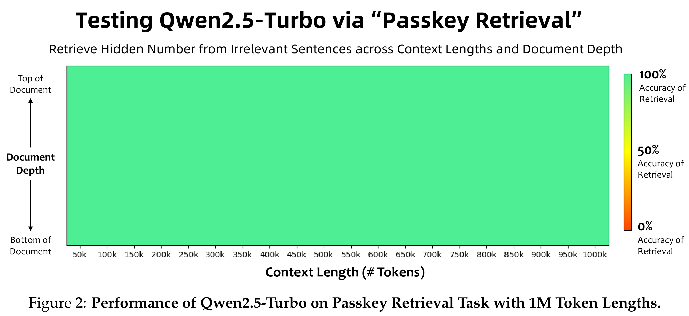

# Qwen2.5 Technical Report

[Official source](https://github.com/QwenLM/Qwen3)

## Abstract

In this report, we introduce Qwen2.5, a comprehensive series of large language models (LLMs) designed to meet diverse needs. Compared to previous iterations, Qwen 2.5 has been significantly improved during both the pre-training and post-training stages. In terms of pre-training, we have scaled the high-quality pre-training datasets from the previous 7 trillion tokens to 18 trillion tokens. This provides a strong foundation for common sense, expert knowledge, and reasoning capabilities. In terms of post-training, we implement intricate supervised finetuning with over 1 million samples, as well as multistage reinforcement learning, including offline learning DPO and online learning GRPO. Post-training techniques significantly enhance human preference, and notably improve long text generation, structural data analysis, and instruction following.

To handle diverse and varied use cases effectively, we present Qwen2.5 LLM series in rich configurations. The open-weight offerings include base models and instruction-tuned models in sizes of 0.5B, 1.5B, 3B, 7B, 14B, 32B, and 72B parameters. Quantized versions of the instruction-tuned models are also provided. Over 100 models can be accessed from Hugging Face Hub, ModelScope, and Kaggle. In addition, for hosted solutions, the proprietary models currently include two mixture-of-experts (MoE) variants: Qwen2.5-Turbo and Qwen2.5-Plus, both available from Alibaba Cloud Model Studio. Qwen2.5 has demonstrated top-tier performance on a wide range of benchmarks evaluating language understanding, reasoning, mathematics, coding, human preference alignment, etc. Specifically, the open-weight flagship Qwen2.5-72B-Instruct outperforms a number of open and proprietary models and demonstrates competitive performance to the state-of-the-art open-weight model, Llama-3-405B-Instruct, which is around 5 times larger. Qwen2.5-Turbo and Qwen2.5-Plus offer superior cost-effectiveness while performing competitively against GPT-4o-mini and GPT-4o respectively. Additionally, as the foundation, Qwen2.5 models have been instrumental in training specialized models such as Qwen2.5-Math (Yang et al., 2024b), Qwen2.5-Coder (Hui et al., 2024), QwQ (Qwen Team, 2024d), and multimodal models.

Figure 2: Performance of Qwen2.5-Turbo on Passkey Retrieval Task with 1M Token Lengths.

p. 17
