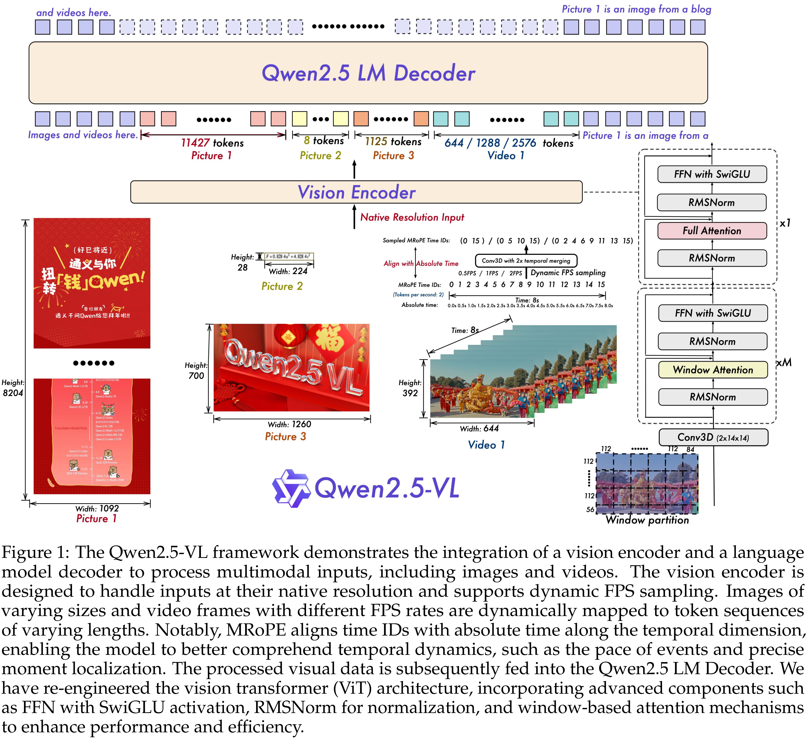

# Qwen2.5-VL Technical Report

[Official source](https://github.com/QwenLM/Qwen3-VL)

## Abstract

We introduce Qwen2.5-VL, the latest flagship model of Qwen vision-language series, which demonstrates significant advancements in both foundational capabilities and innovative functionalities. Qwen2.5-VL achieves a major leap forward in understanding and interacting with the world through enhanced visual recognition, precise object localization, robust document parsing, and long-video comprehension. A standout feature of Qwen2.5-VL is its ability to localize objects using bounding boxes or points accurately. It provides robust structured data extraction from invoices, forms, and tables, as well as detailed analysis of charts, diagrams, and layouts. To handle complex inputs, Qwen2.5-VL introduces dynamic resolution processing and absolute time encoding, enabling it to process images of varying sizes and videos of extended durations (up to hours) with second-level event localization. This allows the model to natively perceive spatial scales and temporal dynamics without relying on traditional normalization techniques. By training a native dynamic-resolution Vision Transformer (ViT) from scratch and incorporating Window Attention, we have significantly reduced computational overhead while maintaining native resolution. As a result, Qwen2.5-VL excels not only in static image and document understanding but also as an interactive visual agent capable of reasoning, tool usage, and task execution in real-world scenarios such as operating computers and mobile devices. The model achieves strong generalization across domains without requiring task-specific fine-tuning. Qwen2.5-VL is available in three sizes, addressing diverse use cases from edge AI to high-performance computing. The flagship Qwen2.5-VL-72B model matches state-of-the-art models like GPT-4o and Claude 3.5 Sonnet, particularly excelling in document and diagram understanding. The smaller Qwen2.5-VL-7B and Qwen2.5-VL-3B models outperform comparable competitors, offering strong capabilities even in resource-constrained environments. Additionally, Qwen2.5-VL maintains robust linguistic performance, preserving the core language competencies of the Qwen2.5 LLM.

Figure 1: The Qwen2.5-VL framework demonstrates the integration of a vision encoder and a language model decoder to process multimodal inputs, including images and videos. The vision encoder is designed to handle inputs at their native resolution and supports dynamic FPS sampling. Images of varying sizes and video frames with different FPS rates are dynamically mapped to token sequences of varying lengths. Notably, MRoPE aligns time IDs with absolute time along the temporal dimension, enabling the model to better comprehend temporal dynamics, such as the pace of events and precise moment localization. The processed visual data is subsequently fed into the Qwen2.5 LM Decoder. We have re-engineered the vision transformer (ViT) architecture, incorporating advanced components such as FFN with SwiGLU activation, RMSNorm for normalization, and window-based attention mechanisms to enhance performance and efficiency.

p. 3
