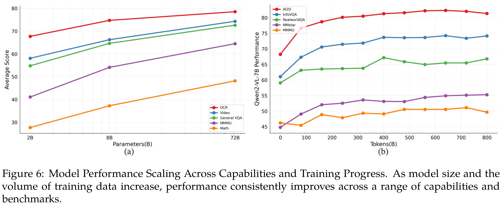

# Qwen2-VL: Enhancing Vision-Language Model's Perception of the World at Any Resolution

[Official source](https://github.com/QwenLM/Qwen3-VL)

## Abstract

We present the Qwen2-VL Series, an advanced upgrade of the previous Qwen-VL models that redefines the conventional predetermined-resolution approach in visual processing. Qwen2-VL introduces the Naive Dynamic Resolution mechanism, which enables the model to dynamically process images of varying resolutions into different numbers of visual tokens. This approach allows the model to generate more efficient and accurate visual representations, closely aligning with human perceptual processes. The model also integrates Multimodal Rotary Position Embedding (M-RoPE), facilitating the effective fusion of positional information across text, images, and videos. We employ a unified paradigm for processing both images and videos, enhancing the model’s visual perception capabilities. To explore the potential of large multimodal models, Qwen2-VL investigates the scaling laws for large vision-language models (LVLMs). By scaling both the model size-with versions at 2B, 8B, and 72B parameters-and the amount of training data, the Qwen2-VL Series achieves highly competitive performance. Notably, the Qwen2-VL-72B model achieves results comparable to leading models such as GPT-4o and Claude3.5-Sonnet across various multimodal benchmarks, outperforming other generalist models. Code is available at https://github.com/QwenLM/Qwen2-VL.

Figure 6: Model Performance Scaling Across Capabilities and Training Progress. As model size and the volume of training data increase, performance consistently improves across a range of capabilities and benchmarks.

p. 16
