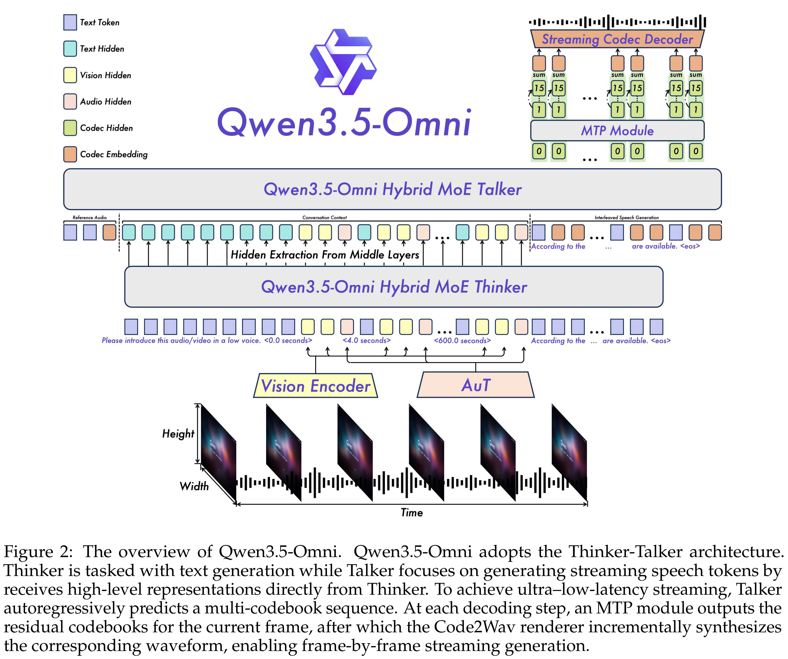
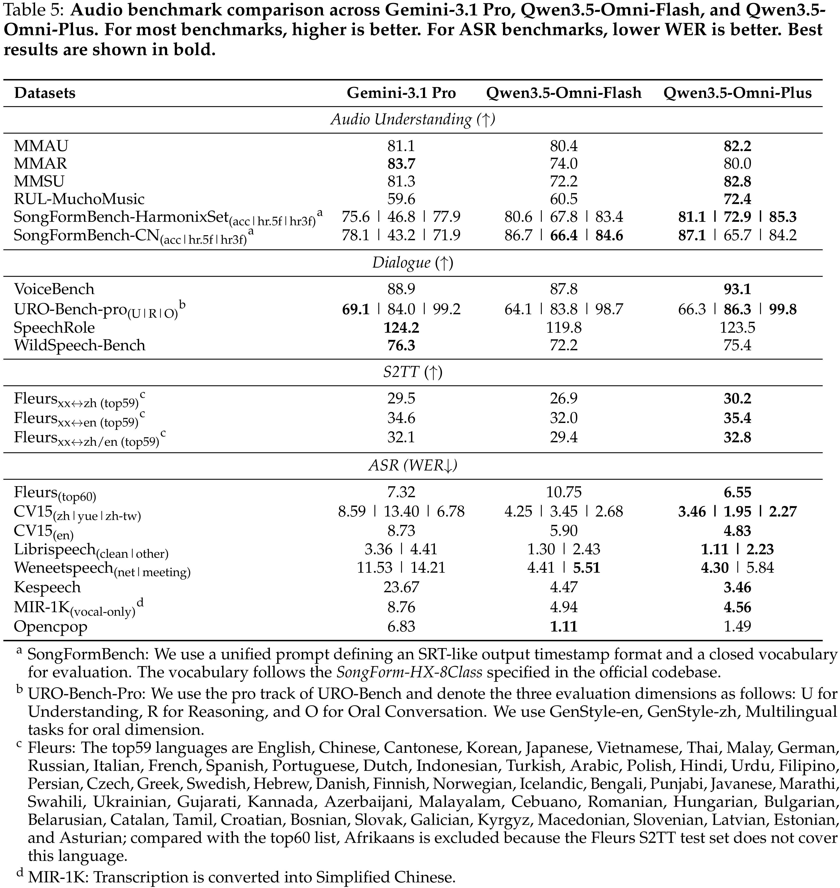

# Qwen3.5-Omni Technical Report

[Official source](https://arxiv.org/abs/2604.15804)

## Abstract

In this work, we present Qwen3.5-Omni, the latest advancement in the Qwen-Omni model family. Representing a significant evolution over its predecessor, Qwen3.5-Omni scales to hundreds of billions of parameters and supports a 256k context length. By leveraging a massive dataset comprising heterogeneous text-vision pairs and over 100 million hours of audio-visual content, the model demonstrates robust omni-modality ca- pabilities. Qwen3.5-Omni-Plus achieves SOTA results across 215 audio and audio-visual understanding, reasoning, and interaction subtasks and benchmarks, surpassing Gemini- 3.1 Pro in key audio tasks and matching it in comprehensive audio-visual understanding. Architecturally, Qwen3.5-Omni employs a Hybrid Attention Mixture-of-Experts (MoE) framework for both Thinker and Talker, enabling efficient long-sequence inference. The model facilitates sophisticated interaction, supporting over 10 hours of audio under- standing and 400 seconds of 720P video (at 1 FPS). To address the inherent instability and unnaturalness in streaming speech synthesis—often caused by encoding efficiency discrepancies between text and speech tokenizers—we introduce ARIA (Adaptive Rate Interleave Alignment). ARIA dynamically aligns text and speech units, significantly enhancing the stability and prosody of conversational speech with minimal latency impact. Furthermore, Qwen3.5-Omni expands linguistic boundaries, supporting mul- tilingual understanding and speech generation across 10 languages with human-like emotional nuance. Beyond preset voices, the model enables zero-shot voice customiza- tion via user-provided samples. Finally, Qwen3.5-Omni exhibits superior audio-visual grounding capabilities, generating script-level structured captions with precise temporal synchronization and automated scene segmentation. Remarkably, we observed the emergence of a new capability in omnimodal models: directly performing coding based on audio-visual instructions, which we call Audio-Visual Vibe Coding. Qwen3.5-Omni is publicly accessible via API1.

Figure 2: The overview of Qwen3.5-Omni. Qwen3.5-Omni adopts the Thinker-Talker architecture. Thinker is tasked with text generation while Talker focuses on generating streaming speech tokens by receives high-level representations directly from Thinker. To achieve ultra–low-latency streaming, Talker autoregressively predicts a multi-codebook sequence. At each decoding step, an MTP module outputs the residual codebooks for the current frame, after which the Code2Wav renderer incrementally synthesizes the corresponding waveform, enabling frame-by-frame streaming generation.

p. 3

Table 5: Audio benchmark comparison across Gemini-3.1 Pro, Qwen3.5-Omni-Flash, and Qwen3.5- Omni-Plus. For most benchmarks, higher is better. For ASR benchmarks, lower WER is better. Best results are shown in bold.

p. 11
