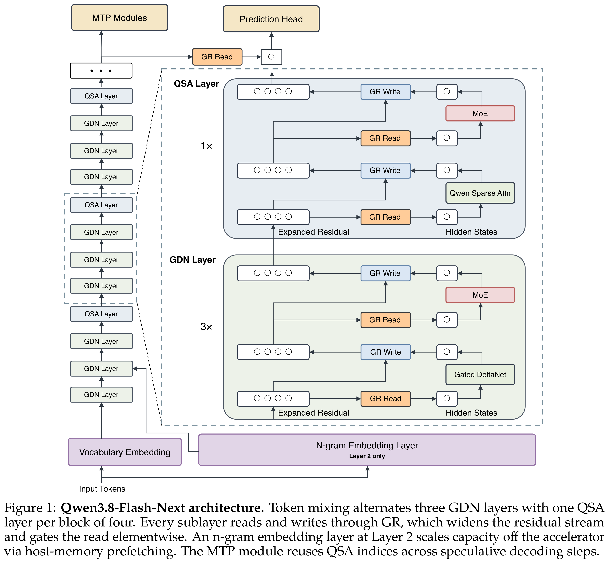
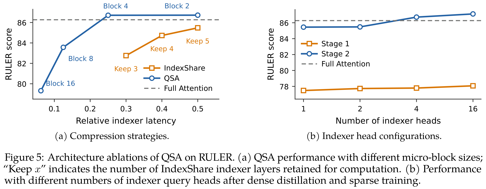

# On the Design of Qwen3.8-Next Architecture: Evaluation, Efficiency, and Training Stability

[Official source](https://github.com/QwenLM/Qwen3.8-Flash-Next)

## Abstract

We describe the architecture and ablations of Qwen3.8-Flash-Next, a sparse mixture-of-experts model with 125B parameters, 6B activated per token, and additional 51B parameters of n-gram embedding tables held off the accelerator. On fourteen pre-training benchmarks the model leads the 397B-A17B predecessor on eight and trails it on the rest by at most 2.6 points, at 1/3 the activated parameters, 1/3 the training tokens, and roughly 1/9 the training FLOPs. Token mixing uses a layer-wise hybrid of Gated DeltaNet (GDN) and global attention, with one full-attention layer in every four; at continued-pretraining time those full-attention layers are replaced by Qwen Sparse Attention (QSA), which scores context at micro-block granularity with a compressed lightweight indexer. The residual stream is widened to four branches and read through an elementwise gate, a design we call the Gated Residual (GR). Capacity is added outside the backbone by a single n-gram embedding layer whose tables are prefetched from host memory. We evaluate every candidate change along three axes: loss together with downstream benchmarks; the cost of the change in training, prefill and decode; and its effect on the optimal hyperparameters and training stability. Loss and downstream accuracy do not always move together: enlarging the n-gram vocabulary lowers loss monotonically while downstream accuracy saturates. The architecture and the Muon optimizer together shift the optimal learning rate and batch size upwards, render batch-size warmup unnecessary, and substantially improve stability under stress tests. Loss, benchmarks, efficiency and stability form one design problem. Solved jointly, they yield a recipe that is simultaneously more efficient, more capable and more stable.

Figure 1: Qwen3.8-Flash-Next architecture. Token mixing alternates three GDN layers with one QSA layer per block of four. Every sublayer reads and writes through GR, which widens the residual stream and gates the read elementwise. An n-gram embedding layer at Layer 2 scales capacity off the accelerator via host-memory prefetching. The MTP module reuses QSA indices across speculative decoding steps.

p. 2

Figure 5: Architecture ablations of QSA on RULER. (a) QSA performance with different micro-block sizes; “Keep x” indicates the number of IndexShare indexer layers retained for computation. (b) Performance with different numbers of indexer query heads after dense distillation and sparse training.

p. 9
