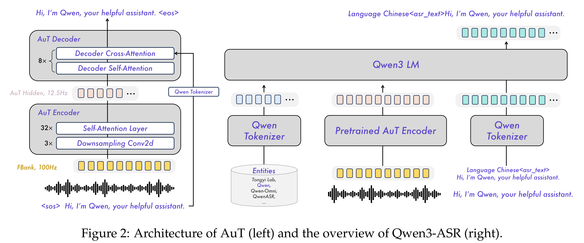
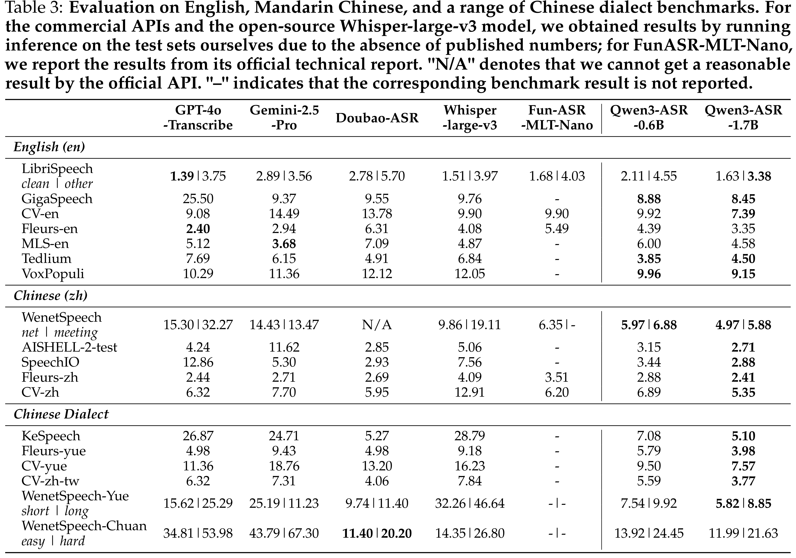

# Qwen3-ASR Technical Report

[Official source](https://github.com/QwenLM/Qwen3-ASR)

## Abstract

In this report, we introduce Qwen3-ASR family, which includes two powerful all-in-one speech recognition models and a novel non-autoregressive speech forced alignment model. Qwen3-ASR-1.7B and Qwen3-ASR-0.6B are ASR models that support language identification and ASR for 52 languages and dialects. Both of them leverage large-scale speech training data and the strong audio understanding ability of their foundation model Qwen3-Omni. We conduct comprehensive internal evaluation besides the open- sourced benchmarks as ASR models might differ little on open-sourced benchmark scores but exhibit significant quality differences in real-world scenarios. The experiments reveal that the 1.7B version achieves state-of-the-art performance among open-sourced ASR models and is competitive with the strongest proprietary APIs while the 0.6B version offers the best accuracy–efficiency trade-off. Qwen3-ASR-0.6B can achieve an average time-to-first-token as low as 92ms and transcribe 2,000 seconds speech in 1 second at a concurrency of 128. Qwen3-ForcedAligner-0.6B is an LLM based NAR timestamp predictor that is able to align text-speech pairs in 11 languages. Timestamp accuracy experiments show that the proposed model outperforms the three strongest force alignment models and takes more advantages in efficiency and versatility. To further accelerate the community research of ASR and audio understanding, we release these models under the Apache 2.0 license.

Figure 2: Architecture of AuT (left) and the overview of Qwen3-ASR (right).

p. 3

Table 3: Evaluation on English, Mandarin Chinese, and a range of Chinese dialect benchmarks. For
the commercial APIs and the open-source Whisper-large-v3 model, we obtained results by running
inference on the test sets ourselves due to the absence of published numbers; for FunASR-MLT-Nano,
we report the results from its official technical report. "N/A" denotes that we cannot get a reasonable
result by the official API. "–" indicates that the corresponding benchmark result is not reported.

p. 8
