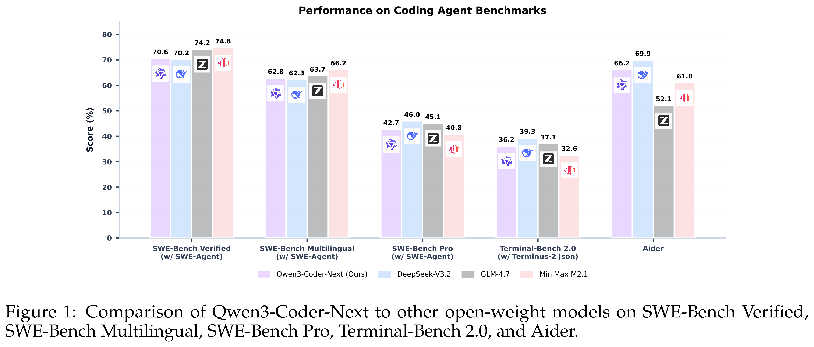
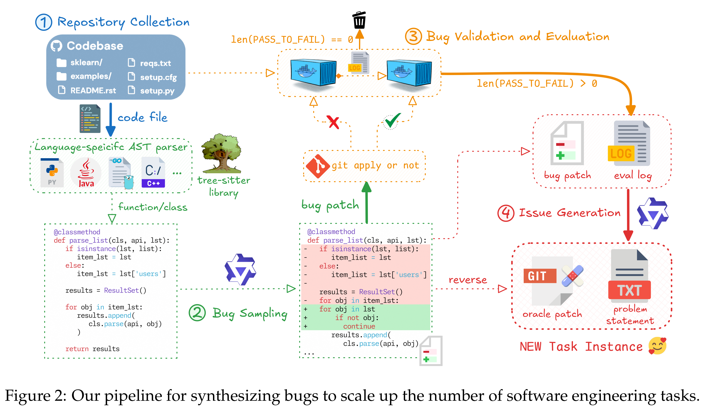

# Qwen3-Coder-Next Technical Report

[Official source](https://github.com/QwenLM/Qwen3-Coder)

## Abstract

We present Qwen3-Coder-Next, an open-weight language model specialized for coding agents. Qwen3-Coder-Next is an 80-billion-parameter model that activates only 3 billion parameters during inference, enabling strong coding capability with efficient inference. In this work, we explore how far strong training recipes can push the capability lim- its of models with small parameter footprints. To achieve this, we perform agentic training through large-scale synthesis of verifiable coding tasks paired with executable environments, allowing learning directly from environment feedback via mid-training and reinforcement learning. Across agent-centric benchmarks including SWE-Bench and Terminal-Bench, Qwen3-Coder-Next achieves competitive performance relative to its active parameter count. We release both base and instruction-tuned open-weight versions to support research and real-world coding agent development.

Figure 1: Comparison of Qwen3-Coder-Next to other open-weight models on SWE-Bench Verified,
SWE-Bench Multilingual, SWE-Bench Pro, Terminal-Bench 2.0, and Aider.

p. 1

Figure 2: Our pipeline for synthesizing bugs to scale up the number of software engineering tasks.

p. 3
