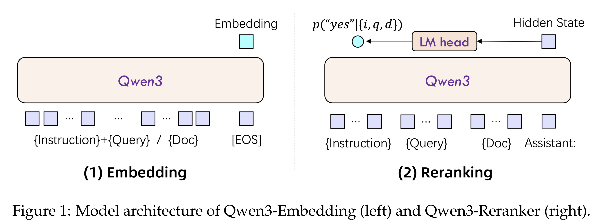
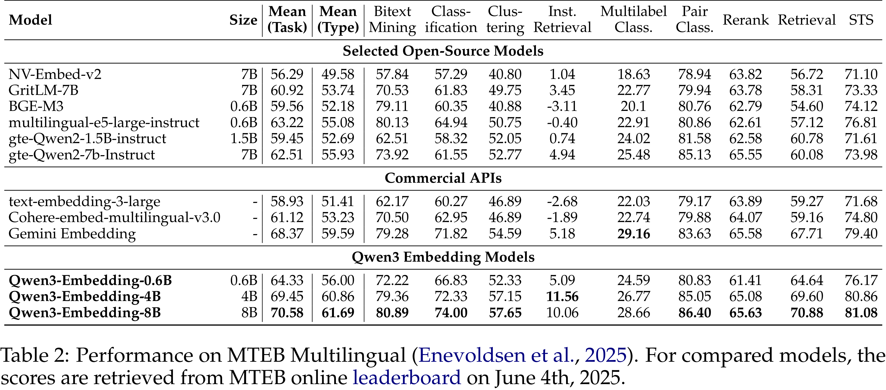

# Qwen3 Embedding: Advancing Text Embedding and Reranking Through Foundation Models

[Official source](https://github.com/QwenLM/Qwen3-Embedding)

## Abstract

In this work, we introduce the Qwen3 Embedding series, a significant advancement over its predecessor, the GTE-Qwen series, in text embedding and reranking capabilities, built upon the Qwen3 foundation models. Leveraging the Qwen3 LLMs’ robust capabilities in multilingual text understanding and generation, our innovative multi-stage training pipeline combines large-scale unsupervised pre-training with supervised fine-tuning on high-quality datasets. Effective model merging strategies further ensure the robustness and adaptability of the Qwen3 Embedding series. During the training process, the Qwen3 LLMs serve not only as backbone models but also play a crucial role in synthesizing high-quality, rich, and diverse training data across multiple domains and languages, thus enhancing the training pipeline. The Qwen3 Embedding series offers a spectrum of model sizes (0.6B, 4B, 8B) for both embedding and reranking tasks, addressing diverse deployment scenarios where users can optimize for either efficiency or effectiveness. Empirical evaluations demonstrate that the Qwen3 Embedding series achieves state-of-the-art results across diverse benchmarks. Notably, it excels on the multilingual evaluation benchmark MTEB for text embedding, as well as in various retrieval tasks, including code retrieval, cross-lingual retrieval and multilingual retrieval. To facilitate reproducibility and promote community-driven research and development, the Qwen3 Embedding models are publicly available under the Apache 2.0 license.

Figure 1: Model architecture of Qwen3-Embedding (left) and Qwen3-Reranker (right).

p. 3

Table 2: Performance on MTEB Multilingual (Enevoldsen et al., 2025). For compared models, the scores are retrieved from MTEB online leaderboard on June 4th, 2025.

p. 6
