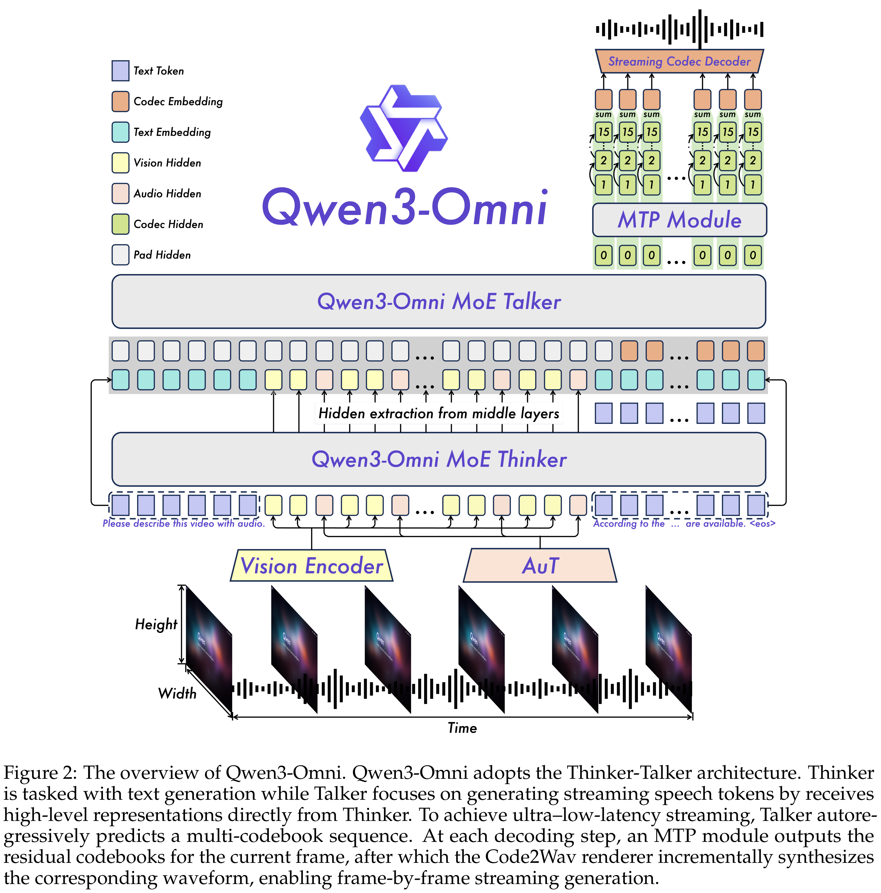
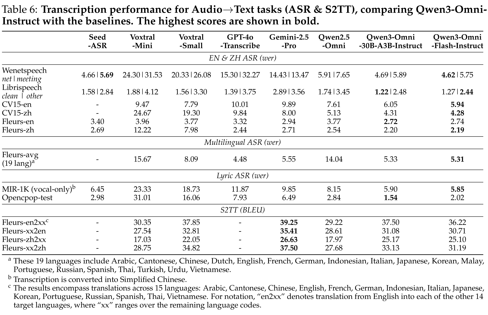

# Qwen3-Omni Technical Report

[Official source](https://github.com/QwenLM/Qwen3-Omni)

## Abstract

We present Qwen3-Omni, a single multimodal model that for the first time maintains state-of-the-art performance across text, image, audio, and video without any degra- dation relative to single-modal counterparts. Qwen3-Omni matches the performance of same-sized single-modal models within the Qwen series and excels particularly on audio tasks. Across 36 audio and audio-visual benchmarks, Qwen3-Omni achieves open- source state-of-the-art (SOTA) on 32 benchmarks and overall SOTA on 22, outperforming strong closed-source models such as Gemini-2.5-Pro, Seed-ASR, and GPT-4o-Transcribe. Qwen3-Omni adopts a Thinker–Talker Mixture-of-Experts (MoE) architecture that uni- fies perception and generation across text, images, audio, and video, yielding fluent text and natural real-time speech. It supports text interaction in 119 languages, speech understanding in 19 languages and speech generation in 10 languages. The system can process audio recordings up to 40 minutes per instance for ASR and spoken-language understanding, enabling high-quality audio and audiovisual experiences across locales. It demonstrates strong instruction following and allows fine-grained customization of conversational tone and persona via user-defined system prompts. To reduce first-packet latency in streaming synthesis, the Talker autoregressively predicts discrete speech codecs using a multi-codebook scheme. Leveraging the representational capacity of these codebooks, we replace computationally intensive block-wise diffusion with a lightweight causal ConvNet, enabling streaming from the first codec frame. In cold-start settings (no prior context), Qwen3-Omni achieves a theoretical end-to-end first-packet latency of 234 ms. To further strengthen multimodal reasoning, we introduce a Think- ing model that explicitly reasons over inputs from any modality. Since the research community currently lacks a general-purpose audio captioning model, we fine-tuned Qwen3-Omni-30B-A3B to obtain Qwen3-Omni-30B-A3B-Captioner, which produces detailed, low-hallucination captions for arbitrary audio inputs. Qwen3-Omni-30B-A3B, Qwen3-Omni-30B-A3B-Thinking and Qwen3-Omni-30B-A3B-Captioner are publicly released under the Apache 2.0 license.

Figure 2: The overview of Qwen3-Omni. Qwen3-Omni adopts the Thinker-Talker architecture. Thinker
is tasked with text generation while Talker focuses on generating streaming speech tokens by receives
high-level representations directly from Thinker. To achieve ultra–low-latency streaming, Talker autore-
gressively predicts a multi-codebook sequence. At each decoding step, an MTP module outputs the
residual codebooks for the current frame, after which the Code2Wav renderer incrementally synthesizes
the corresponding waveform, enabling frame-by-frame streaming generation.

p. 3

Table 6: Transcription performance for Audio→Text tasks (ASR & S2TT), comparing Qwen3-Omni-
Instruct with the baselines. The highest scores are shown in bold.

p. 10
