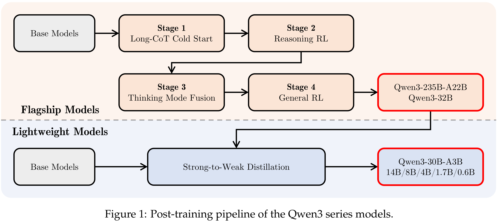

# Qwen3 Technical Report

[Official source](https://github.com/QwenLM/Qwen3)

## Abstract

In this work, we present Qwen3, the latest version of the Qwen model family. Qwen3 comprises a series of large language models (LLMs) designed to advance performance, efficiency, and multilingual capabilities. The Qwen3 series includes models of both dense and Mixture-of-Expert (MoE) architectures, with parameter scales ranging from 0.6 to 235 billion. A key innovation in Qwen3 is the integration of thinking mode (for complex, multi-step reasoning) and non-thinking mode (for rapid, context-driven responses) into a unified framework. This eliminates the need to switch between different models—–such as chat-optimized models (e.g., GPT-4o) and dedicated reasoning models (e.g., QwQ- 32B)—–and enables dynamic mode switching based on user queries or chat templates. Meanwhile, Qwen3 introduces a thinking budget mechanism, allowing users to allocate computational resources adaptively during inference, thereby balancing latency and performance based on task complexity. Moreover, by leveraging the knowledge from the flagship models, we significantly reduce the computational resources required to build smaller-scale models, while ensuring their highly competitive performance. Empirical evaluations demonstrate that Qwen3 achieves state-of-the-art results across diverse benchmarks, including tasks in code generation, mathematical reasoning, agent tasks, etc., competitive against larger MoE models and proprietary models. Compared to its predecessor Qwen2.5, Qwen3 expands multilingual support from 29 to 119 languages and dialects, enhancing global accessibility through improved cross-lingual understanding and generation capabilities. To facilitate reproducibility and community-driven research and development, all Qwen3 models are publicly accessible under Apache 2.0.

Figure 1: Post-training pipeline of the Qwen3 series models.

p. 9
