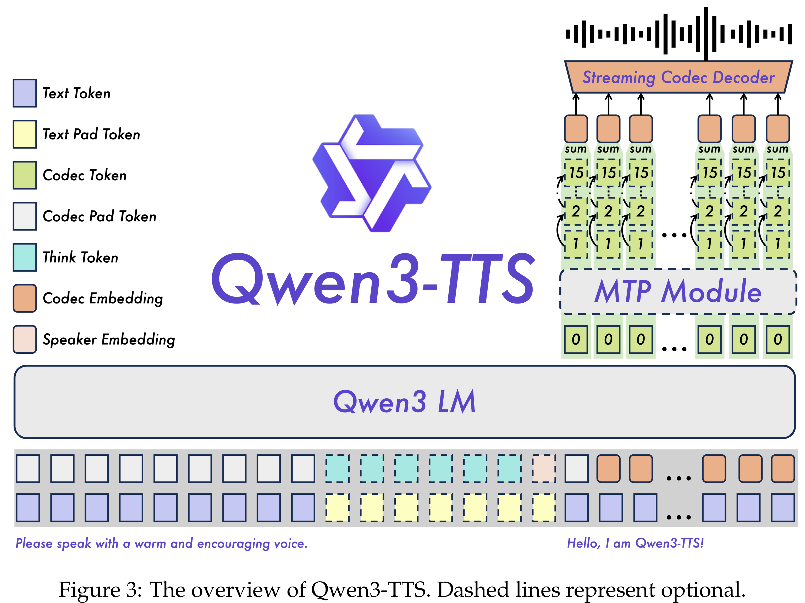
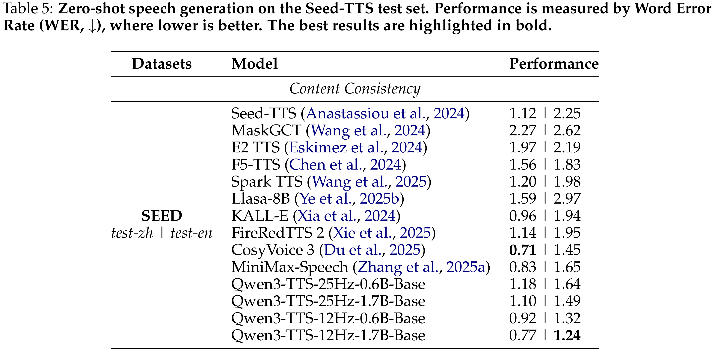

# Qwen3-TTS Technical Report

[Official source](https://github.com/QwenLM/Qwen3-TTS)

## Abstract

In this report, we present the Qwen3-TTS series, a family of advanced multilingual, controllable, robust, and streaming text-to-speech models. Qwen3-TTS supports state-of-the-art 3-second voice cloning and description-based control, allowing both the creation of entirely novel voices and fine-grained manipulation over the output speech. Trained on over 5 million hours of speech data spanning 10 languages, Qwen3-TTS adopts a dual-track LM architecture for real-time synthesis, coupled with two speech tokenizers: 1) Qwen-TTS-Tokenizer-25Hz is a single-codebook codec emphasizing semantic content, which offers seamlessly integration with Qwen-Audio and enables streaming waveform reconstruction via a block-wise DiT. 2) Qwen-TTS-Tokenizer-12Hz achieves extreme bitrate reduction and ultra-low-latency streaming, enabling immediate first-packet emission (97 ms) through its 12.5 Hz, 16-layer multi-codebook design and a lightweight causal ConvNet. Extensive experiments indicate state-of-the-art performance across diverse objective and subjective benchmark (e.g., TTS multilingual test set, InstructTTSEval, and our long speech test set). To facilitate community research and development, we release both tokenizers and models under the Apache 2.0 license.

Figure 3: The overview of Qwen3-TTS. Dashed lines represent optional.

p. 4

Table 5: Zero-shot speech generation on the Seed-TTS test set. Performance is measured by Word Error Rate (WER, ↓), where lower is better. The best results are highlighted in bold.

p. 8
